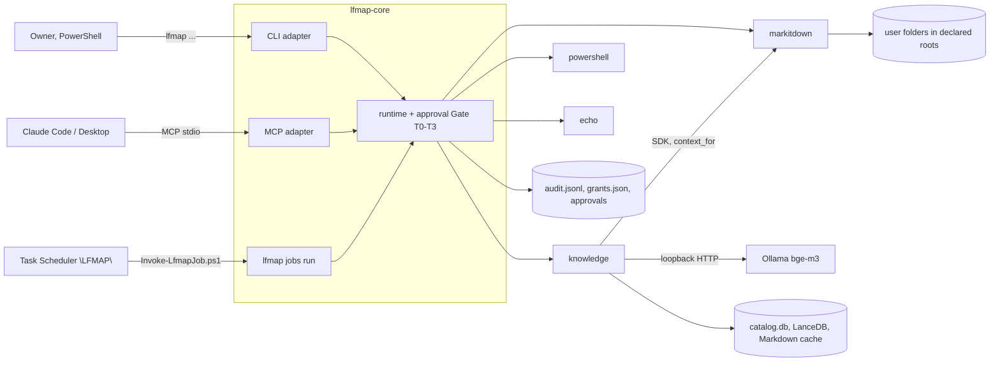

# Architecture

A short map of LFMAP for contributors and Claude sessions. The full Phase 1 architecture document (Vietnamese) is `docs/phase1/01_Architecture.md`; decisions live in the ADRs outside the repository. Update this file in the same PR when the module map, a main flow or an invariant changes.

## Shape

One Python workspace (`uv`), Windows-first, no background service. Business logic lives in a plugin's `Tool` class; `lfmap-core` generates the adapters from each plugin's `lfmap.toml` manifest.

## Module map

| Path | Role |
| --- | --- |
| `packages/lfmap-core` | `Tool`, `@operation`, `ToolContext`, `ToolError` (`tool.py`, `errors.py`); manifest schema (`manifest.py`); plugin discovery via the `lfmap.plugins` entry point (`registry.py`); building tools and contexts (`runtime.py`); user config `%LOCALAPPDATA%\lfmap\config.toml` (`config.py`); Permission Manager (`permissions.py`); risk tiers, policy and audit log (`approval.py`), time-limited grants (`grants.py`), job approval queue (`approvals.py`); scheduled jobs and doctor (`jobs.py`, `jobs_doctor.py`); EventBus: topics and patterns (`topics.py`), `Event` and the `EventBus` Protocol with an in-process bus (`events.py`), durable SQLite bus with leases and dead letters (`events_sqlite.py`), retry, payload and operation-topic helpers (`events_retry.py`, `events_payload.py`, `events_names.py`); `ctx.events`, the user's bus `events.db` and the event adapter (`events_adapter.py`); generated adapters (`cli.py`, `mcp_adapter.py`); telemetry off (`telemetry.py`) |
| `packages/lfmap-knowledge` | Plugin `knowledge`: scan roots (`scanner.py`), extract Markdown through markitdown with a hash cache (`extract.py`), chunk (`chunker.py`), FTS5 with Vietnamese folding (`fts.py`), Ollama embeddings (`embed.py`), LanceDB (`vectors.py`), SQLite catalog and migrations (`store.py`, `catalog.py`), file edges (`edges.py`), hybrid search and `get_context` (`search.py`), reindex and status (`indexer.py`) |
| `plugins/lfmap-markitdown` | Plugin `markitdown`: `classify`, `convert`, `export`, `info`; backends MarkItDown (default), OCR (`[ocr]` extra) and Docling (`[docling]` extra, PDF only, offline models); text-quality checks ported from MarkitdownTool |
| `plugins/lfmap-powershell` | Plugin `powershell`: runs only allow-listed scripts (hash-pinned, typed arguments) without a shell, with timeout and capped output; tier per script (ADR-020, default T3) |
| `plugins/lfmap-echo` | Reference plugin |
| `scripts/` | `check_licenses.py` (CI licence gate), `Invoke-LfmapJob.ps1` (runs one job, JSON log) |
| `docs/` | `specs/`, `handoff/`, `research/`, phase acceptance sets `phase0/`, `phase1/`, provenance |

## Main flows

1. **Operation call.** An adapter resolves the plugin and operation, `runtime.build_tool` creates the `ToolContext` (permissions, `data_dir`, settings, channel, approver), and the approval `Gate` maps `side_effects` to a tier: `none` T0, `local_write` T1, `external` T3. T2/T3 ask a human (CLI TTY prompt, MCP elicitation, `--approve`, grant) according to the channel; every decision above T0 is written to `audit.jsonl`.
2. **Scheduled job.** Task Scheduler runs `Invoke-LfmapJob.ps1`, which runs `lfmap jobs run` and exits. A job never asks: calls above its `max_tier` become proposals in `approvals\pending\`, approved later at a TTY.
3. **Knowledge reindex.** Under a single-writer lock: reconcile files, extract changed ones through markitdown (in-process SDK call with the caller's rights), chunk, index FTS5, embed in batches, write LanceDB, garbage-collect.
4. **Question over MCP.** `knowledge_search` / `knowledge_get_context`: keyword and vector search fused with RRF, weak hits pruned, packed to a token budget with citations. `secret` roots never leave on `mcp`/`rest`; every call that returns content writes `egress_log`.
5. **Event.** No daemon: handlers run only while `lfmap events run` or the end of `lfmap jobs run` drains `%LOCALAPPDATA%\lfmap\events.db` (bounded by `--max-seconds` / `--max-events`). A plugin with `[adapters] events = true` publishes its own topics through `ctx.events`. Core publishes `<plugin>.<operation>.requested`; the event adapter (`adapter-<plugin-id>`) runs the operation like a job (channel `event`, capped at `[events] max_tier`, otherwise a proposal) and publishes `.completed` or `.failed`. Delivery is at least once, so handlers must be idempotent; failed handlers retry with backoff and end as dead letters (`lfmap events dead`, `retry` at a TTY).

## Invariants

- Adapters stay generic: no plugin-specific code in `cli.py` or `mcp_adapter.py`. Plugins call each other through the SDK (`context_for`), never through CLI or MCP.
- Every caller-supplied path goes through `PermissionManager.require_read` / `require_write` before file-system access; the final check is `realpath` plus an inline `startswith` guard. UNC, `\\?\`, `\\.\` and `//` paths are refused before any I/O.
- Folders come only from the user's `config.toml`; no operation writes it. Self-granting commands (`config add-folder`, `approvals grant/revoke/approve/reject`) and the queue-changing `events retry/prune` run only at a TTY and have no MCP form. On Windows a TTY means a console stdin (`GetConsoleMode`) with a visible console window; `grant`, `revoke` and `add-folder` also need a random 6-character code typed back. This gate stops scripts, piped or `NUL` stdin and accidents, not an agent of the same Windows user that drives a real console (issue #108; separate-user ADR pending).
- T3 is never covered by `--yes`, `--approve` or elicitation.
- No network beyond loopback: markitdown converts opened streams only, the embedder accepts loopback URLs and ignores proxy variables.
- Runtime dependencies must carry a licence in the manifest's `allowed` list (`scripts/check_licenses.py`).
- Writing a plugin's own `data_dir` is not a side effect (ADR-016).
- Events: a plugin publishes only with `[adapters] events = true`, only `<plugin-id>.…` topics (two tokens or more), with `source` set to its id; `<plugin>.<operation>.requested|completed|failed` are published by core only. An event call runs on channel `event`, never asks anyone and is capped at `[events] max_tier` (default 0); above it the call becomes a proposal (`job = "events"`). `events.db` has a fixed path in the app folder.

## Review habits

- Redraw the diagram above (or a richer one as an Artifact page) at the end of each Roadmap phase and after a large refactor; note any drift from this file in the PR.
- Run `/security-review` before merging a code PR that touches caller-supplied paths, adapters, network calls, subprocesses or `.claude/`. CodeQL runs on every PR.
