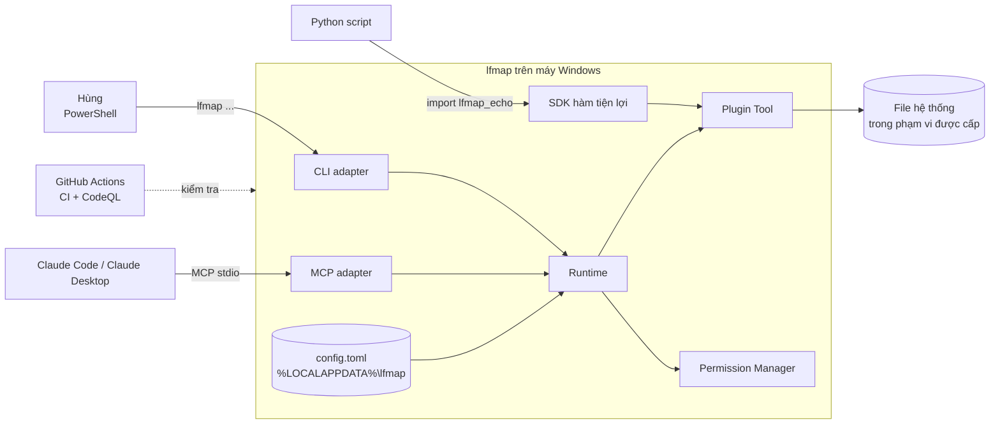
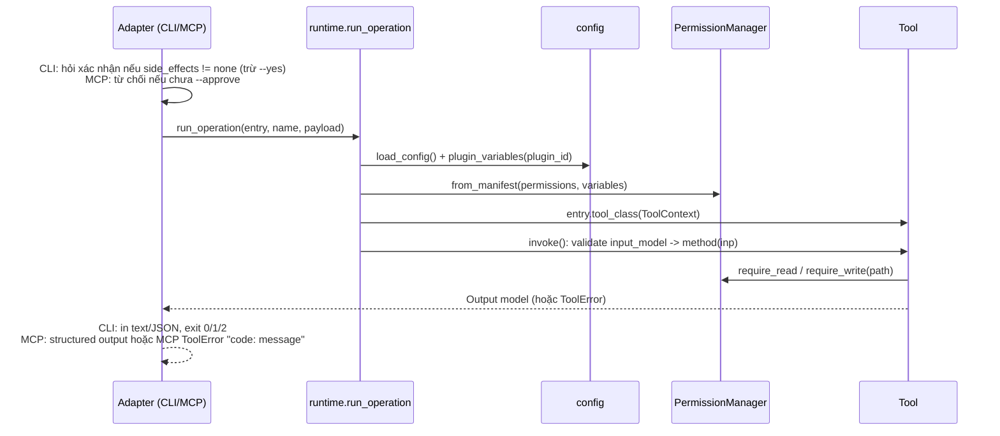

# LFMAP Phase 0 — Tài liệu Kiến trúc (SAD)

| Mục | Giá trị |
|---|---|
| Phiên bản tài liệu | 1.0 (2026-10-19) |
| Phạm vi | Phase 0 — Foundation (Roadmap 0.1–0.8) |
| Mốc code | `hungnp1999/lfmap` commit `f63f0ee` (PR #1 `c08c673` + PR #2 `f63f0ee`) |
| Ngoài phạm vi | lfmap-core 0.2: PR #3 (TC-C2), #5 (TC-C4a), #6 (TC-C4b) — sẽ vào bộ tài liệu Phase 1 |
| Nguồn thiết kế | ADR-001, 002, 003, 004, 008, 009, 010, 014; Plugin Contract v0.1.1; Blueprint v0.2 |

## 1. Mục tiêu kiến trúc

Một plugin chỉ viết logic nghiệp vụ một lần (class `Tool` + model Pydantic) và có **SDK, CLI, MCP** miễn phí (ADR-001, ADR-003). Mọi truy cập file của plugin bị giới hạn bởi khai báo `[permissions]` trong manifest và thư mục người dùng tự cấu hình (ADR-009).

Thuộc tính chất lượng ưu tiên: duy trì được bởi một người, chạy local trên Windows, không dịch vụ nền, không framework orchestration (ADR-004), bảo mật đường dẫn mặc định từ chối.

## 2. Ngữ cảnh hệ thống (C4 mức 1)



Không có thành phần mạng, cơ sở dữ liệu hay tiến trình nền nào ở Phase 0. MCP server chỉ chạy khi client (Claude) khởi động nó qua stdio.

## 3. Cấu trúc repo và bản đồ module

```text
lfmap/
├── pyproject.toml                     # uv workspace root (package = false), pytest config
├── ruff.toml, .pre-commit-config.yaml # lint/format
├── packages/lfmap-core/src/lfmap_core/
│   ├── errors.py        # ToolError, ErrorCode
│   ├── tool.py          # Tool, ToolContext, OperationSpec, @operation, invoke()
│   ├── manifest.py      # schema lfmap.toml (Pydantic, extra=forbid), parse/load
│   ├── registry.py      # discovery entry point "lfmap.plugins", PluginEntry, Registry
│   ├── config.py        # config.toml người dùng, biến ${...} cho permissions
│   ├── permissions.py   # PermissionManager: fs_read / fs_write / network
│   ├── runtime.py       # build_tool(), run_operation(), default_context()
│   ├── cli.py           # Typer app sinh tự động, entry `lfmap`
│   └── mcp_adapter.py   # MCPServer (mcp 2.3.0) sinh tự động, stdio
├── plugins/lfmap-echo/src/lfmap_echo/
│   ├── lfmap.toml       # manifest mẫu
│   ├── schemas.py       # SayInput, SayOutput
│   ├── tool.py          # EchoTool.say
│   └── __init__.py      # SDK: say()
├── scripts/check_licenses.py          # kiểm tra giấy phép dependency runtime
└── .github/workflows/{ci,codeql}.yml  # CI Windows + CodeQL
```

| Module | Trách nhiệm | Phụ thuộc nội bộ | Roadmap | ADR |
|---|---|---|---|---|
| `errors.py` | 6 mã lỗi chuẩn, `ToolError.to_dict()` | — | 0.2 | Contract §6 |
| `tool.py` | Đánh dấu operation, suy ra input/output từ type hints, validate payload và gọi method | errors | 0.2 | 001 |
| `manifest.py` | Schema và đọc `lfmap.toml` | errors | 0.3 | 002 |
| `registry.py` | Quét entry point, đối chiếu manifest với class, bỏ qua plugin hỏng | tool, manifest | 0.3 | 002 |
| `config.py` | Đọc `config.toml`, sinh biến `[paths]` + `data_dir`/`temp_dir` | errors | 0.6 | 009 |
| `permissions.py` | Mở rộng biến, chặn đường dẫn mạng, kiểm tra nằm trong root | manifest, errors | 0.6 | 009 |
| `runtime.py` | Lắp `ToolContext` + `PermissionManager` cho adapter | config, permissions, registry, tool | 0.2–0.6 | 001 |
| `cli.py` | Lệnh `plugins list`, `<plugin> <operation>`, `serve mcp`; mã thoát | registry, runtime | 0.4 | 003 |
| `mcp_adapter.py` | Mỗi operation thành một MCP tool `<plugin>_<operation>`; chặn tác dụng phụ chưa duyệt | registry, runtime | 0.5 | 003, 009, 014 |
| `check_licenses.py` | So giấy phép package đã cài với danh sách `allowed` của các manifest | — | 0.7 | 010 |

Quy tắc phụ thuộc: adapter (`cli`, `mcp_adapter`) chỉ gọi `runtime` và `registry`; không có code riêng cho plugin nào trong adapter. `tool.py`, `errors.py` không import adapter.

## 4. Luồng chính

### 4.1 Khởi động và discovery

```mermaid
sequenceDiagram
  participant Main as cli.main()
  participant Reg as Registry.discover()
  participant EP as importlib.metadata
  participant LE as load_entry()
  Main->>Reg: discover()
  Reg->>EP: entry_points(group="lfmap.plugins")
  loop mỗi entry point
    Reg->>EP: point.load() -> class
    Reg->>LE: đọc lfmap.toml cạnh module (importlib.resources)
    LE-->>Reg: PluginEntry hoặc ToolError
    Note over Reg: tên entry point phải = plugin.id;<br/>operations khai báo = operations cài đặt;<br/>lỗi -> log warning, bỏ qua plugin
  end
  Main->>Main: build_app(registry) sinh lệnh Typer
```

### 4.2 Gọi một operation (CLI và MCP dùng chung)



### 4.3 Kiểm tra đường dẫn (`PermissionManager._require`)

1. Chuỗi bắt đầu bằng `\\`, `//` hoặc `\??\` → `permission_denied` (trước mọi I/O, tránh lộ NTLM hash).
2. `expanduser` → `abspath` → `normpath`, so `normcase` với từng root (ranh giới phải là hết chuỗi hoặc `os.sep`, chặn `D:\Docs2` khớp nhầm `D:\Docs`).
3. `realpath` (giải symlink/junction) rồi so lại **inline** `startswith` với root đã `realpath` (mẫu CodeQL `py/path-injection` nhận ra).
4. Root được mở rộng từ manifest lúc dựng tool: biến không định nghĩa → không cấp gì (log warning); root tương đối → `invalid_input`; root mạng → `permission_denied`. Root ghi cũng là root đọc.

## 5. Mô hình dữ liệu cấu hình

| Thực thể | Định nghĩa | Ai ghi |
|---|---|---|
| Manifest `lfmap.toml` | `manifest.Manifest`: `plugin`, `operations[]`, `permissions`, `adapters`, `dependencies.licenses` (mọi khóa lạ bị từ chối) | Tác giả plugin, đóng gói trong wheel |
| Config người dùng | `%LOCALAPPDATA%\lfmap\config.toml` hoặc `LFMAP_CONFIG`; `[paths] name = path | [paths]` | Chỉ người dùng (không operation nào ghi) |
| Biến dựng sẵn | `${data_dir}` = `%LOCALAPPDATA%\lfmap\<plugin>`, `${temp_dir}` = `<data_dir>\tmp` (tạo khi dựng tool) | Runtime |
| `ToolContext` | `plugin_id`, `dry_run`, `permissions` | Runtime |

## 6. Quyết định kiến trúc áp dụng

| ADR | Nội dung | Hiện thực ở Phase 0 |
|---|---|---|
| 001 | Core + Adapters | `tool.py` + `cli.py`/`mcp_adapter.py` sinh tự động |
| 002 | Manifest + entry points | `manifest.py`, `registry.py`, `[project.entry-points."lfmap.plugins"]` |
| 003 | Thứ tự SDK → CLI → MCP → REST | SDK, CLI, MCP xong; REST là Roadmap 1.3 |
| 004 | Không agent framework ở Phase 0–1 | Không dependency orchestration |
| 008 | uv workspace, Python 3.12, Windows-first | `pyproject.toml` root, CI `windows-latest` |
| 009 | Permission Manager theo manifest | `permissions.py`, `config.py`; MCP `--approve` (sau này ADR-017 sửa phần xác nhận) |
| 010 | Apache-2.0 | `LICENSE`, `license` trong pyproject và manifest |
| 014 | Tên MCP tool `<plugin>_<operation>` | `mcp_adapter.tool_name()` |

## 7. Công nghệ và giấy phép runtime

| Thành phần | Phiên bản ràng buộc | Giấy phép | Vai trò |
|---|---|---|---|
| Python | `>=3.12,<3.15` | PSF-2.0 | Runtime |
| pydantic | `>=2` | MIT | Schema input/output, manifest |
| typer | `>=0.27.3` | MIT | CLI |
| mcp | `==2.3.0` (pin cứng) | MIT | MCP server stdio |
| hatchling | build backend | MIT | Đóng gói |
| Dev: pytest, ruff, pre-commit | `>=9`, `>=0.17`, `>=4` | MIT | Test, lint |
| Local AI (0.8, ngoài repo) | Ollama 0.40.1; qwen2.5-coder:14b; bge-m3 | MIT; Apache-2.0; MIT | Model local cho Task Card |

Ngoại lệ đã duyệt trong `scripts/check_licenses.py`: `cffi` (MIT-0).

## 8. Bảo mật

- Mặc định từ chối: plugin không khai báo `fs_read`/`fs_write` thì không đọc/ghi được gì qua Permission Manager; SDK (`default_context`) cấp quyền rỗng.
- Caller (kể cả agent AI qua MCP) không mở rộng được phạm vi: biến `${...}` chỉ lấy từ `config.toml` của người dùng.
- Đường dẫn mạng/thiết bị bị chặn trước I/O.
- MCP: operation có `side_effects` khác `none` chỉ chạy khi người dùng `--approve` lúc khởi động server; `external` không được duyệt trước.
- stdout bị chuyển sang stderr khi chạy tool trong MCP để thư viện bên thứ ba không làm hỏng luồng giao thức.
- CI: quyền `contents: read`; action bên thứ ba (`astral-sh/setup-uv`) pin theo SHA; CodeQL `security-extended` cho Python và Actions.

## 9. Giới hạn đã biết ở mốc Phase 0

| # | Giới hạn | Ảnh hưởng | Xử lý |
|---|---|---|---|
| L1 | `ToolContext` chưa có logger, settings, data_dir, cancellation | Plugin phải tự lo | Đã bổ sung ở core 0.2 (PR #3) |
| L2 | `permissions.exec`, `cloud_ai` chỉ khai báo, chưa kiểm tra | Chưa plugin nào dùng | Roadmap 1.6 (powershell) |
| L3 | `min_core_version` và chuỗi `input`/`output` trong manifest chưa đối chiếu với code (chỉ đối chiếu tên operation) | Manifest có thể ghi sai kiểu mà không báo | Backlog |
| L4 | `dry_run` có trong context nhưng chưa adapter nào bật | — | Backlog |
| L5 | Kiểm tra đường dẫn rồi mới dùng (TOCTOU), junction có thể đổi giữa hai bước | Rủi ro thấp trên máy một người dùng | Theo dõi, giống MarkitdownTool #6 |
| L6 | Duyệt MCP `--approve` có hiệu lực suốt đời tiến trình server | Thô | ADR-017 thay bằng duyệt theo tầng (PR #5, #6) |
| L7 | Chưa có REST adapter | — | Roadmap 1.3 |
