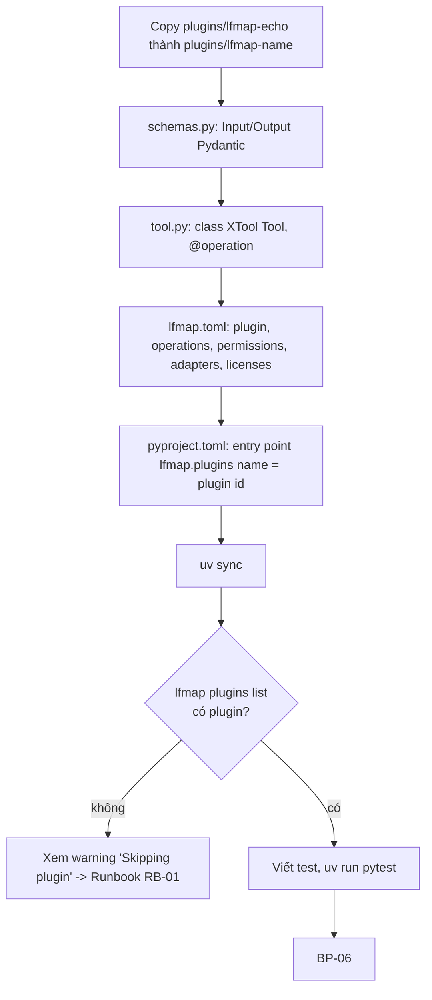
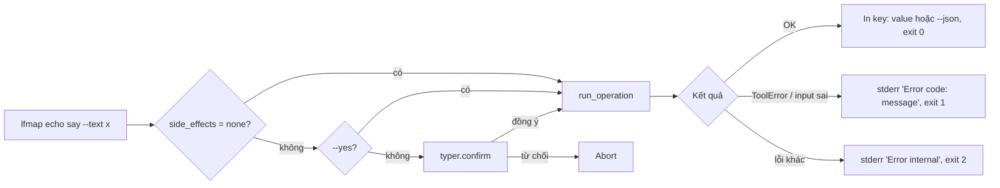

# LFMAP Phase 0 — Tài liệu Quy trình nghiệp vụ (BPD)

Phiên bản 1.0 · 2026-10-19 · Mốc code `f63f0ee`

Tài liệu mô tả các quy trình mà Phase 0 hỗ trợ, ai tham gia, và mỗi bước chạy qua đoạn code nào. Mã quy trình (BP-xx) được dùng trong FS, TC và Runbook.

## 1. Vai trò

| Vai trò | Ai | Làm gì |
|---|---|---|
| Chủ dự án / người dùng | Hùng | Cấu hình thư mục, gọi CLI, phê duyệt tác dụng phụ, nghiệm thu |
| Tác giả plugin | Hùng, model local (qwen), Claude | Viết `Tool`, schema, manifest |
| Agent AI | Claude Code / Claude Desktop | Gọi operation qua MCP trong phạm vi được cấp |
| CI | GitHub Actions | Lint, test, kiểm giấy phép, CodeQL |

## 2. Danh sách quy trình

| Mã | Quy trình | Kích hoạt | Kết quả |
|---|---|---|---|
| BP-01 | Phát triển một plugin mới | Có nhu cầu tool mới | Plugin cài vào workspace, có CLI + MCP + SDK |
| BP-02 | Cấu hình thư mục được phép | Lần đầu dùng plugin cần file | `config.toml` có `[paths]` |
| BP-03 | Gọi operation qua CLI | Người dùng gõ lệnh | Kết quả text/JSON, mã thoát |
| BP-04 | Agent gọi operation qua MCP | Claude cần dùng tool | Structured output hoặc lỗi có mã |
| BP-05 | Phê duyệt tác dụng phụ | Operation có `side_effects` ≠ `none` | Chạy hoặc từ chối |
| BP-06 | Đóng góp code qua PR | Có thay đổi | PR merge sau CI + CodeQL xanh |
| BP-07 | Giao việc cho model local (Task Card) | Việc nhỏ có test rõ | Code đạt test, Claude review gộp |

## 3. Chi tiết

### BP-01 Phát triển plugin mới

Kiểm soát tự động: `registry.load_entry()` từ chối plugin khi tên operation trong manifest khác với `@operation` trong class, hoặc tên entry point khác `plugin.id`; `manifest.Manifest` từ chối khóa lạ; `tool._spec()` từ chối method không đúng chữ ký một model vào, một model ra.

### BP-02 Cấu hình thư mục được phép

1. Người dùng tạo `%LOCALAPPDATA%\lfmap\config.toml` (hoặc đặt `LFMAP_CONFIG`).
2. Khai báo `[paths]`, ví dụ `documents = ['D:\Docs']`.
3. Manifest plugin tham chiếu `${documents}` trong `fs_read`/`fs_write`.
4. Khi chạy operation, `config.plugin_variables()` + `PermissionManager.from_manifest()` biến chúng thành root tuyệt đối.

Quy tắc nghiệp vụ: chỉ người dùng sửa file này; không operation nào ghi nó; biến chưa khai báo nghĩa là không cấp quyền.

### BP-03 Gọi operation qua CLI

Code: `cli._operation_command()`, `cli.main()`.

### BP-04 Agent gọi qua MCP

1. Người dùng đăng ký server một lần: `claude mcp add lfmap -- uv run --directory D:\Development\lfmap lfmap serve mcp --plugins echo`.
2. Claude khởi động server stdio, đọc danh sách tool `<plugin>_<operation>` kèm JSON Schema, mô tả, gợi ý `readOnlyHint`/`openWorldHint`.
3. Claude gọi tool; adapter chạy BP-05 nếu có tác dụng phụ, rồi `run_operation`.
4. Lỗi nghiệp vụ trả về dạng `"<code>: <message> 
"` để agent tự sửa input.

Code: `mcp_adapter.build_server()`, `_make_tool()`.

### BP-05 Phê duyệt tác dụng phụ (theo ADR-009 ở mốc Phase 0)

| Kênh | `side_effects = none` | `local_write` | `external` |
|---|---|---|---|
| CLI | Chạy | Hỏi xác nhận (bỏ qua bằng `--yes`) | Hỏi xác nhận (bỏ qua bằng `--yes`) |
| MCP | Chạy | Chỉ chạy nếu server khởi động với `--approve <plugin>.<op>` | Luôn từ chối; `--approve` cho nó làm server không khởi động |

Lưu ý: từ core 0.2 (PR #5, #6), quy trình này được thay bằng phê duyệt theo tầng T0–T3 của ADR-017. Tài liệu Phase 1 sẽ mô tả quy trình mới.

### BP-06 Đóng góp code qua PR

1. Nhánh từ `main` mới nhất; cập nhật `CHANGELOG.md` mục `[Unreleased]`.
2. Mở PR → CI (`ci.yml`, Windows): kiểm giấy phép runtime → cài dev → `ruff check`, `ruff format --check` → `pytest` → smoke test CLI `lfmap echo say --text "xin chao" --json`.
3. CodeQL (`codeql.yml`, Python + Actions, `security-extended`).
4. Merge khi CodeQL và test xanh, PR không phải draft (quy tắc Managing Agent trong `CLAUDE.md`).

### BP-07 Giao việc cho model local

Planner (Claude) viết Task Card (file đích, ngữ cảnh tối thiểu, test kiểm chứng) → Hùng chạy qwen2.5-coder:14b qua Ollama trên DIEP-ANH → chạy test → Claude review gộp theo Review Checklist. Ở Phase 0: 13 Task Card TC-00…TC-12 (xem `Phase0_Plan_2026-10-18.md`).
