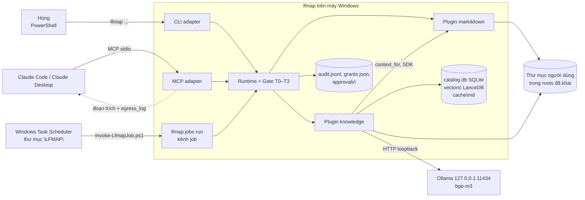
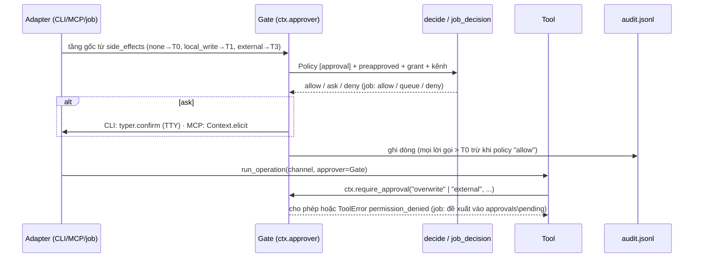
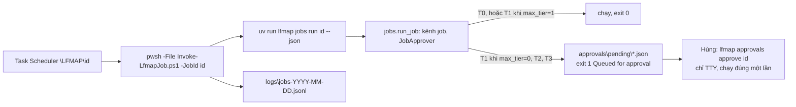
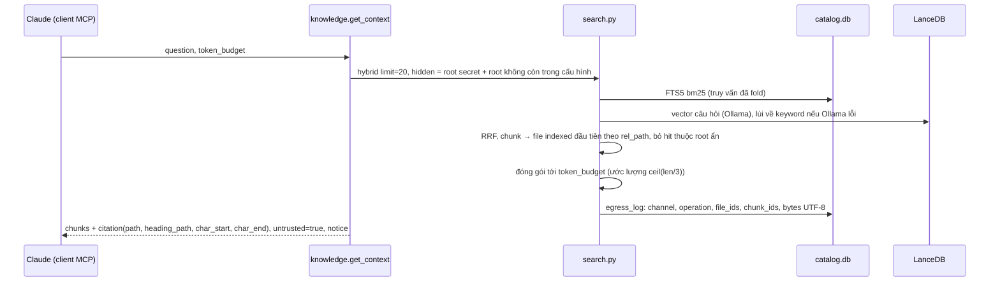

# LFMAP Phase 1 — Tài liệu Kiến trúc (SAD)

| Mục | Giá trị |
|---|---|
| Phiên bản tài liệu | 1.0 (2026-10-22), đã nghiệm thu MVP Phase 1 |
| Phạm vi | Phase 1 — MVP Document → Knowledge → Answer: core 0.2 (điều kiện tiên quyết), Roadmap 1.1, 1.4, 1.5, 1.7, 1.8 |
| Chưa làm | 1.2 Docling, 1.3 REST (Phase 1b). 1.6 `powershell` xong sau mốc (PR #43), đặc tả `docs/specs/powershell.md` |
| Mốc code | `hungnp1999/lfmap` commit `b002710` trên `main` (PR #3 … #39) |
| Nguồn thiết kế | ADR-011 … ADR-018 (cùng các ADR Phase 0); Plugin Contract; `docs/specs/knowledge.md`, `docs/specs/jobs.md`; project files `phase1-specs/` (00 Overview, 01 Core Prereqs, 02 markitdown) |

Tài liệu này chỉ mô tả phần mới hoặc đổi so với Phase 0. Phần không đổi (Tool, `@operation`, manifest, discovery, kiểm tra đường dẫn) xem `docs/phase0/01_Architecture.md`.

## 1. Mục tiêu kiến trúc

Từ một thư mục PDF/DOCX trên máy, Claude trả lời có trích dẫn đoạn nguồn, và nội dung tài liệu chỉ rời máy ở mức đoạn được truy xuất (Exit criteria Phase 1). Để làm được, Phase 1 thêm ba lớp trên khung Phase 0:

1. **Core 0.2**: cấu hình người dùng thật, ngữ cảnh plugin đầy đủ (`data_dir`, `settings`, `channel`), phê duyệt theo tầng rủi ro T0–T3 có audit (ADR-016, ADR-017).
2. **Hai plugin nghiệp vụ**: `markitdown` (chuyển tài liệu sang Markdown, port từ MarkitdownTool) và `knowledge` (catalog, chỉ mục từ khóa + vector, `get_context` có trích dẫn).
3. **Tự động hóa không cần người ngồi máy**: job theo lịch qua Windows Task Scheduler, lời gọi rủi ro cao thành đề xuất chờ duyệt (ADR-018).

Thuộc tính chất lượng giữ nguyên Phase 0: một người duy trì được, local-first, không dịch vụ nền của riêng LFMAP, mặc định từ chối. Dịch vụ ngoài process duy nhất là Ollama (localhost) cho embedding.

## 2. Ngữ cảnh hệ thống (C4 mức 1)



- Dữ liệu tài liệu chỉ rời máy qua kênh `mcp` (client là Claude, chạy trên cloud): đúng các đoạn `search`/`get_context` trả về, mỗi lời gọi ghi một dòng `egress_log`. Root `secret` không bao giờ trả qua `mcp`/`rest`.
- Không plugin nào gọi mạng ngoài loopback: markitdown chỉ dùng `convert_stream` trên handle đã mở; knowledge chỉ nhận URL Ollama loopback và bỏ qua biến proxy môi trường.
- Job không có tiến trình nền của LFMAP: Task Scheduler gọi script, script gọi `lfmap jobs run` rồi thoát.

## 3. Cấu trúc repo và bản đồ module

```text
lfmap/
├── packages/lfmap-core/src/lfmap_core/      # 0.2.0
│   ├── tool.py, runtime.py      # ToolContext mở rộng, require_approval, context_for (đổi)
│   ├── config.py                # config.toml, biến [paths], add_folder (đổi)
│   ├── permissions.py           # explicit_read cho CLI tương tác (đổi)
│   ├── approval.py              # tầng T0–T3, Policy, decide, job_decision, Gate, audit.jsonl (mới)
│   ├── grants.py                # quyền có thời hạn grants.json (mới)
│   ├── approvals.py             # hàng đợi đề xuất của job (mới)
│   ├── jobs.py, jobs_doctor.py  # jobs.toml, schtasks, doctor (mới)
│   ├── cli.py, mcp_adapter.py   # nhóm lệnh approvals/config/audit/jobs; elicitation, --approve 8 giờ (đổi)
├── packages/lfmap-knowledge/src/lfmap_knowledge/   # 0.1.0
│   ├── schemas.py, lfmap.toml, tool.py    # 7 operation
│   ├── store.py                 # SQLite schema v1, migrate, indexer.lock
│   ├── scanner.py               # đối soát catalog với thư mục, BLAKE2b-256
│   ├── extract.py               # gọi markitdown, cache Markdown theo hash
│   ├── chunker.py, fts.py       # chunk theo heading; FTS5 + fold tiếng Việt
│   ├── embed.py, vectors.py     # Ollama embedder (loopback); LanceDB
│   ├── indexer.py               # reindex, status
│   ├── catalog.py, edges.py, search.py    # truy vấn file, cạnh/related, search/get_context
├── plugins/lfmap-markitdown/src/lfmap_markitdown/  # 0.1.0
│   ├── formats.py, schemas.py, lfmap.toml, tool.py, scan.py, quality.py
│   └── backends/{base,markitdown,ocr}.py   # ocr chỉ có khi cài extra [ocr]
├── plugins/lfmap-echo/          # không đổi
├── scripts/Invoke-LfmapJob.ps1  # chạy một job, ghi log JSON (mới)
├── scripts/check_licenses.py    # quét cả packages/*, EXCEPTIONS mới (đổi)
└── docs/{jobs.md, specs/, handoff/, phase0/, phase1/}
```

| Module | Trách nhiệm | Roadmap | ADR |
|---|---|---|---|
| `approval.py` | Ánh xạ `side_effects` → tầng; chính sách `[approval]`; bảng quyết định cho cli/mcp/sdk và cho job; `Gate` gắn vào `ctx.approver`; ghi `audit.jsonl` | core 0.2 | 017, 018 |
| `grants.py` | Quyền có thời hạn (T1–T2 ≤ 7 ngày, T3 ≤ 24 giờ), hết hạn = không có | core 0.2 | 017 |
| `approvals.py` | Đề xuất JSON trong `approvals\pending\`, gộp đề xuất trùng, hết hạn, chuyển trạng thái (không bao giờ xóa) | 1.8 | 018 |
| `jobs.py` | Schema `jobs.toml`, chạy job kênh `job`, dựng lệnh `schtasks` (chỉ `\LFMAP\`), tìm `uv`/`pwsh` theo đường dẫn đầy đủ | 1.8 | 018 |
| `jobs_doctor.py` | Kiểm tra máy chỉ đọc: uv, pwsh, jobs.toml, task, logon, wake, sleep, Ollama | 1.8 | 018 |
| markitdown `tool.py` | `classify`, `convert`, `export`, `info`; mọi đường dẫn qua `require_read/write`; ghi đè gọi `require_approval("overwrite")` | 1.1 | 011, 015 |
| markitdown `backends/ocr.py` | OCRmyPDF (rasterizer pypdfium, không Ghostscript), Tesseract trên máy | 1.1 | D3 (extra Internal) |
| knowledge `indexer.py` | Thuật toán reindex (spec §4) trong `writer_lock`; `status` đọc bằng kết nối readonly | 1.4 | 013, 016 |
| knowledge `search.py` | keyword/vector/hybrid (RRF k=60), ánh xạ chunk → file, ẩn root, `egress_log`, đóng gói `get_context` | 1.4, 1.5 | 012, 013 |

Quy tắc phụ thuộc giữ nguyên: adapter không có code riêng của plugin nào. `knowledge` gọi `markitdown` qua SDK trong cùng process (`context_for`), không qua CLI/MCP. Rule `edges`/`catalog`/`search` không mở file người dùng; chỉ `scanner` và `extract` (qua markitdown) đọc file, sau `require_read`.

## 4. Luồng chính

### 4.1 Gọi operation có phê duyệt theo tầng (CLI, MCP, job dùng chung)



Quy tắc không đổi theo tầng: roots, chặn UNC/thiết bị, `network`. Tầng chỉ quyết định có phải hỏi người hay không.

| Tầng | CLI tương tác | CLI không TTY | MCP | Job |
|---|---|---|---|---|
| T0 | chạy | chạy | chạy | chạy |
| T1 | chạy + audit | chạy + audit | chạy + audit | `max_tier = 1`: chạy + audit; `0`: đề xuất |
| T2 | hỏi; `--yes` | cần `--yes` | `--approve` (8 giờ), elicitation, hoặc grant | đề xuất |
| T3 | hỏi (chỉ CLI có TTY), grant, hoặc đích duyệt trước | grant hoặc đích duyệt trước; `--yes` không đủ | grant hoặc đích duyệt trước; `--approve` và elicitation không đủ | đề xuất |

`[approval]` trong `config.toml` chỉ làm chặt hơn ở T3 (không hạ dưới "ask"); `deny` thắng mọi thứ và job không xếp hàng lời gọi bị `deny`.

### 4.2 Job theo lịch



### 4.3 knowledge reindex (spec §4)

1. `writer_lock(data_dir)`; lấy không được → `backend_unavailable`, `reason = indexer_busy`.
2. Đồng bộ bảng `roots` với `${knowledge}` hiện tại (trừ `data_dir`) và `sensitivity`; root bị bỏ khỏi cấu hình → file của nó thành `deleted`; root có trong cấu hình nhưng thư mục không tồn tại → đếm lỗi, không xóa gì.
3. `scanner.reconcile`: không vào junction/symlink, bỏ hidden/system/`~$*`/`exclude`; cùng `size` + `mtime_ns` thì chỉ cập nhật `last_seen`; khác thì hash; định dạng không hỗ trợ vẫn nằm trong catalog (`skipped/unsupported_format`).
4. Trích xuất file `pending` qua `markitdown.convert` (cache `cache\md\ab\<hash>.md`), chunk, ghi `chunks` + FTS + cạnh; một nội dung chỉ trích một lần theo hash; lỗi 3 lần → `error`.
5. GC nội dung không còn file sống; embed nội dung chưa có vector của model hiện tại (lô 32). Ollama không chạy → `embed_skipped_reason`, không tính là lỗi.
6. `full=True`: bỏ mọi bảng vector và FTS, dựng lại từ cache Markdown. `vectors\` bị xóa → embed lại, không trích lại.

### 4.4 Hỏi qua MCP (`knowledge_get_context`)



## 5. Dữ liệu và cấu hình

### 5.1 Thư mục dữ liệu người dùng (`%LOCALAPPDATA%\lfmap\`)

| Đường dẫn | Nội dung | Ai ghi |
|---|---|---|
| `config.toml` (`LFMAP_CONFIG`) | `[paths]`, `[plugins.<id>.settings]`, `[approval]`, `[approval.operations]`, `[approval.destinations."host"]`, `[jobs] approval_ttl_days` | Người dùng; `lfmap config add-folder` (chỉ TTY) |
| `audit.jsonl` | Một dòng JSON mỗi quyết định > T0, grant/revoke, approve/reject, `read_outside_roots`; không có nội dung tài liệu | Core |
| `grants.json` | Quyền có thời hạn | `lfmap approvals grant/revoke` (chỉ TTY) |
| `jobs.toml` (`LFMAP_JOBS`) | Khai báo job | Người dùng |
| `approvals\{pending,done,rejected,expired}\` | Đề xuất của job | Core (chỉ chuyển thư mục, không xóa) |
| `logs\jobs-YYYY-MM-DD.jsonl` | Kết quả mỗi lần chạy job | `Invoke-LfmapJob.ps1` |
| `<plugin>\` (`${data_dir}`), `<plugin>\tmp\` | Dữ liệu riêng của plugin (ADR-016: ghi ở đây là T0) | Plugin |
| `knowledge\catalog.db`, `vectors\`, `cache\md\`, `indexer.lock` | Chỉ mục knowledge | knowledge |

### 5.2 `catalog.db` (SQLite, WAL, `user_version = 1`)

| Bảng | Vai trò |
|---|---|
| `roots` | root đã khai, `sensitivity` (`normal`/`private`/`secret`), `last_scan` |
| `files` | mỗi file trong root: `rel_path`, `name_folded`, `ext`, `size`, `mtime_ns`, `content_hash`, `status` (`pending`/`indexed`/`skipped`/`error`/`deleted`), `reason_code`, `attempts`; hàng đợi trích xuất chính là `status = pending` |
| `contents` | một dòng mỗi nội dung (BLAKE2b-256): `extractor_version`, `chunk_count`, `embed_model`, `embedded_at` |
| `chunks`, `chunks_fts` | đoạn có `heading_path`, `char_start/char_end` trỏ vào Markdown cache; FTS5 contentless trên văn bản đã fold |
| `edges` | `GENERATED_FROM`, `REFERENCES` (lưu); `duplicate`, `same_folder`, `similar_content` tính khi hỏi |
| `egress_log` | mỗi lời gọi `search`/`get_context` trên `mcp`/`rest` có trả nội dung |

LanceDB: một bảng mỗi model embedding (`chunks_bge_m3`), cột `chunk_id`, `content_hash`, `vector` 1024 chiều; chỉ mục ANN `IVF_HNSW_SQ` cosine từ 50.000 vector (kết quả TC-K0).

### 5.3 `ToolContext` (core 0.2)

`plugin_id`, `dry_run`, `permissions`, `data_dir`, `temp_dir`, `settings`, `channel` (`sdk`/`cli`/`mcp`/`rest`/`job`), `approver`. `context_for(plugin_id, parent)` cho lời gọi plugin-trong-plugin: quyền và kênh của caller, `data_dir`/`settings` của plugin được gọi, không thêm quyền nào.

## 6. Quyết định kiến trúc áp dụng ở Phase 1

| ADR | Nội dung | Hiện thực |
|---|---|---|
| 009 → 017 | Phê duyệt theo tầng T0–T3, quyền có thời hạn, đích duyệt trước | `approval.py`, `grants.py`, `mcp_adapter.py`, `cli.py` |
| 011 | Office cũ chỉ trong GUI MarkitdownTool | markitdown trả `office_gui_only` cho `.doc .rtf .odt .ppt .odp .ods` |
| 012 | Knowledge Infrastructure là phần mở rộng của lfmap-knowledge | Phạm vi cắt gọn D6: không watch, không tóm tắt LLM, không Magika trực tiếp (X4) |
| 013 | SQLite + LanceDB nhúng, không Qdrant/Docker | `store.py`, `vectors.py`; interface `VectorStore` để thay sau |
| 014 | Tên tool MCP `<plugin>_<operation>` | `knowledge_get_context`, `markitdown_convert` … |
| 015 | MPL-2.0 dùng nguyên bản, theo từng plugin | `allowed` của markitdown và knowledge có `MPL-2.0` (certifi, tqdm) |
| 016 | Ghi `data_dir` riêng không tính là tác dụng phụ | Mọi operation knowledge là `none`, kể cả `reindex` |
| 018 | Job qua Task Scheduler + hàng đợi file | `jobs.py`, `approvals.py`, `Invoke-LfmapJob.ps1`; lệnh hàng đợi là `approvals pending` (Hùng chốt 2026-10-21; `approvals list` vẫn là danh sách grant) |
| 004 + B6 | Không framework agent; vòng qwen chỉ nhận card S có test chặt | `qwen-loop` nằm ngoài repo sản phẩm (Roadmap 1.7) |

## 7. Công nghệ và giấy phép runtime mới

| Thành phần | Phiên bản | Giấy phép | Dùng ở |
|---|---|---|---|
| markitdown `[docx,pptx,xlsx,xls,pdf]` | `==0.1.8` | MIT (kéo `certifi` MPL-2.0) | markitdown |
| pypdfium2 | `>=5.14` | Apache-2.0 / BSD-3-Clause (ngoại lệ đã duyệt) | markitdown (phân loại PDF) |
| lancedb | `==0.40.0` | Apache-2.0 (kéo `pyarrow` Apache-2.0, `tqdm` MPL-2.0 AND MIT) | knowledge |
| Extra `[ocr]`: ocrmypdf, pillow | `==17.13.0`, `>=12` | MPL-2.0 (kéo fpdf2, img2pdf LGPL-3.0); MIT-CMU | markitdown, chỉ cài tay, phân loại Internal (D3) |
| Tesseract (ngoài Python) | winget | Apache-2.0 | OCR |
| Ollama + bge-m3 (ngoài Python) | 0.40.1; dim 1024 | MIT; MIT | embedding |
| SQLite FTS5 | stdlib | Public domain | knowledge |

Ngoại lệ trong `scripts/check_licenses.py`: `cffi`, `numpy`, `pillow`, `pypdfium2` (lý do ghi ngay trong file). CI kiểm giấy phép trên cài đặt mặc định (không extra), nên LGPL của `[ocr]` không vào bản phân phối.

## 8. Bảo mật

- Mọi đường dẫn từ caller qua `require_read`/`require_write` trước I/O, kể cả trong knowledge (`search_files`, `get_file`, `search`, `get_context`, `related`) và markitdown (`output_dir` tương đối bị từ chối).
- Đọc ngoài root chỉ ở CLI tương tác (người gõ là người duyệt), có audit `read_outside_roots`; MCP và CLI không TTY chỉ trong root; ghi không bao giờ nới.
- Lệnh tự cấp quyền chỉ chạy ở TTY và không có qua MCP: `config add-folder`, `approvals grant/revoke/approve/reject`. Agent không tự mở rộng phạm vi hay tự duyệt việc của mình.
- T3 không bao giờ được `--approve`, `--yes` hay elicitation phủ; grant T3 tối đa 24 giờ; đích duyệt trước tối đa 90 ngày và không nhận dữ liệu `secret`.
- knowledge: root `secret` (và root đã bỏ khỏi cấu hình hoặc vừa đổi sang `secret` nhưng chưa reindex) bị ẩn trên `mcp`/`rest` ở mọi operation; kết quả luôn `untrusted = true` kèm `notice`; mô tả MCP nói rõ kết quả là dữ liệu, không phải chỉ dẫn.
- Cạnh `REFERENCES` chỉ xử lý chuỗi: link UNC, tuyệt đối, có ổ đĩa, có scheme bị bỏ, cả sau percent-decode; không mở đường dẫn trong link.
- `vectors.delete_content` kiểm `content_hash` là 64 hex trước khi đưa vào bộ lọc LanceDB (chặn injection).
- Embedder chỉ nhận URL loopback và bỏ qua `HTTP(S)_PROXY`; markitdown không gọi `convert` với URL.
- Job: không bao giờ hỏi, bỏ qua grant/`--approve`/đích duyệt trước; `approve` chạy đúng một lần (chuyển file sang `done` trước khi chạy); file đề xuất bị sửa tay không hạ được tầng đã khai.

## 9. Giới hạn đã biết ở mốc Phase 1

Trạng thái giới hạn Phase 0: L1, L6 đã xử lý ở core 0.2; L2 (`exec`, `cloud_ai` chưa kiểm), L3 (`min_core_version` chưa đối chiếu), L5 (TOCTOU), L7 (REST) vẫn mở; L4 (`dry_run`) vẫn mở, xem L13.

| # | Giới hạn | Ảnh hưởng | Xử lý |
|---|---|---|---|
| L8 | Chưa có REST (1.3), Docling (1.2) | Phase 1 chưa đủ hạng mục Roadmap | Phase 1b (`07` §6); 1.6 xong ở PR #43 |
| L9 | Core không đối chiếu `min_core_version` của manifest | Plugin cần core 0.2 vẫn nạp được trên core cũ | Backlog core |
| L10 | `audit.jsonl` luôn ở `%LOCALAPPDATA%\lfmap\`, không theo `LFMAP_CONFIG`; lần đọc bị từ chối không ghi audit | Thử nghiệm tách cấu hình vẫn ghi chung audit | Backlog core |
| L11 | Tiến độ `reindex` in ra stderr khi kênh `cli` (tạm) | Không có hook tiến độ chung cho MCP | Chờ core có progress hook |
| L12 | Ước lượng token `ceil(len/3)` thô; fold tiếng Việt làm "ma" khớp "mà/má/mã" | `get_context` có thể thiếu hoặc thừa; tìm từ khóa không dấu kém chính xác | Vector bù; đo trên tài liệu thật (K14) |
| L13 | Đề xuất của job chưa có `preview` (chưa operation nào khai báo dry run) | Người duyệt chỉ thấy input, không thấy kết quả dự kiến | Khi Plugin Contract có `dry_run` |
| L14 | Prompt injection từ tài liệu chỉ được giảm bằng `untrusted` + mô tả | Client vẫn có thể làm theo nội dung tài liệu | Không hứa hơn; theo dõi |
| L15 | knowledge gọi markitdown bằng quyền của knowledge (`context_for`) | markitdown đọc được mọi thứ trong `${knowledge}` dù `${documents}` hẹp hơn | Đúng thiết kế spec §7.7 |
| L16 | Job chỉ chạy trên Windows; `jobs register` (`/F`) đặt lại "Run whether user is logged on" và "Wake" | Phải đặt lại tay sau mỗi lần register | `docs/jobs.md`; `jobs doctor` cảnh báo |
| L17 | OCR là extra Internal (LGPL); CI Windows không có Tesseract nên test OCR bị skip | OCR chỉ kiểm trên máy có Tesseract | Plugin `ocr` (PaddleOCR) Phase 2 |
| L18 | LanceDB cảnh báo deprecation về tự chiếu cột `_distance` | Có thể vỡ khi nâng lancedb | Đã sửa sau mốc: PR #40 (chọn `_distance` tường minh) |
| L19 | Embed lần đầu chậm: 10.000 file mất ~1 giờ (3,75 file/s sau PR #44, GPU chưa dùng hết) | Lần lập chỉ mục đầu của thư mục lớn kéo dài | PR #45 không cải thiện; #46 thêm `embed_concurrency` (song song, cần `OLLAMA_NUM_PARALLEL`); reindex lần hai đạt (7,2 s) |
| L20 | markitdown đổi đoạn mở đầu in nghiêng của một số `.docx` thành heading | `heading_path` thành một câu dài | Theo dõi; xử lý ở chunker hoặc markitdown (TC-918) |
| L21 | PDF không có heading Markdown | `heading_path` rỗng, trích dẫn chỉ có đường dẫn + vị trí ký tự | Chấp nhận ở MVP; Docling (1.2) có thể cải thiện |
| L22 | `.doc` và Office cũ bị bỏ qua (`office_gui_only`) | Thư mục thật: 9/17 file không vào chỉ mục | Chuyển bằng app MarkitdownTool (ADR-011) rồi index file `.md` |
| L23 | `get_context` thường lấy đầy ngân sách 4000 token | Tốn ngữ cảnh của client | Giảm `token_budget` khi hỏi; xem lại mặc định ở Phase 1b |
