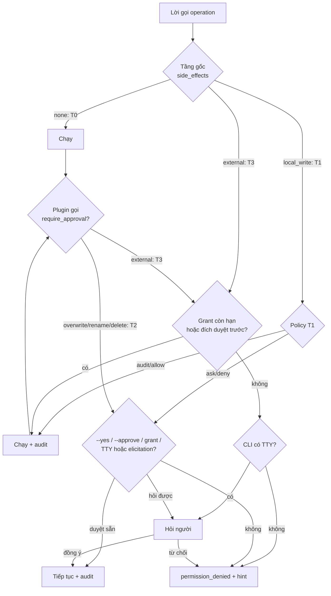
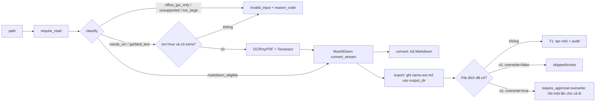
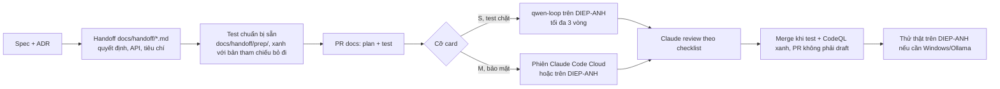

# LFMAP Phase 1 — Tài liệu Quy trình nghiệp vụ (BPD)

Phiên bản 0.9 bản nháp · 2026-10-22 · Mốc code `b002710`

Tài liệu mô tả các quy trình Phase 1 thêm hoặc đổi so với Phase 0, ai tham gia, và mỗi bước chạy qua đoạn code nào. Mã quy trình nối tiếp Phase 0 (BP-01 … BP-07). BP-05 (phê duyệt) và BP-07 (giao việc cho model local) được thay bằng BP-09 và BP-15.

## 1. Vai trò

| Vai trò | Ai | Làm gì |
|---|---|---|
| Chủ dự án / người dùng | Hùng | Khai thư mục, chọn độ nhạy, duyệt đề xuất của job, cấp quyền có thời hạn, nghiệm thu |
| Managing Agent | Claude (project: coordinator + thread) | Lập kế hoạch, soạn handoff + test chuẩn bị sẵn, mở phiên Working Agent, review, merge |
| Working Agent | Claude Code (Cloud hoặc trên DIEP-ANH), qwen2.5-coder:14b (card S) | Viết code theo task |
| Agent AI dùng sản phẩm | Claude Code / Claude Desktop qua MCP | Gọi `knowledge_*`, `markitdown_*` trong phạm vi được cấp |
| Bộ lập lịch | Windows Task Scheduler (`\LFMAP\`) | Gọi `Invoke-LfmapJob.ps1` theo lịch |
| CI | GitHub Actions | License check, lint, test, smoke CLI, CodeQL |

## 2. Danh sách quy trình

| Mã | Quy trình | Kích hoạt | Kết quả |
|---|---|---|---|
| BP-08 | Khai thư mục và độ nhạy | Lần đầu dùng markitdown/knowledge | `config.toml` có `[paths]` và `sensitivity` |
| BP-09 | Phê duyệt theo tầng T0–T3 (thay BP-05) | Mọi lời gọi operation | Chạy, hỏi, hoặc từ chối; audit |
| BP-10 | Cấp và thu hồi quyền có thời hạn | Cần cho agent làm việc T2/T3 trong một khoảng thời gian | `grants.json`, audit |
| BP-11 | Chuyển tài liệu sang Markdown | Cần Markdown của một file hoặc cả thư mục | Markdown trả về hoặc file `.md` mới |
| BP-12 | Lập chỉ mục knowledge | Lần đầu, hoặc theo lịch | `catalog.db`, `vectors\` cập nhật |
| BP-13 | Hỏi tài liệu qua Claude | Hùng hỏi Claude về tài liệu local | Câu trả lời có trích dẫn; `egress_log` |
| BP-14 | Job theo lịch và duyệt đề xuất | Task Scheduler đến giờ | Chạy (T0/T1) hoặc đề xuất chờ duyệt |
| BP-15 | Giao việc cho Working Agent (thay BP-07) | Một task trong handoff | PR merge sau CI + CodeQL xanh |

## 3. Chi tiết

### BP-08 Khai thư mục và độ nhạy

1. Ở terminal tương tác: `uv run lfmap config add-folder D:\Docs --as documents|exports|knowledge`. Lệnh từ chối UNC, chỉ thêm một dòng vào `[paths]` (giữ comment), ghi audit. Không có qua MCP và từ chối khi không có TTY.
2. Độ nhạy (chỉ knowledge) sửa tay trong `[plugins.knowledge.settings.sensitivity]`: `normal` (mặc định), `private` (trả mọi kênh, có `egress_log`), `secret` (chỉ `cli`/`sdk`).
3. Kiểm tra: `uv run lfmap config path` in file cấu hình đang dùng và root đã mở rộng của từng plugin.

Quy tắc: chỉ người ở máy mới mở rộng phạm vi; root đổi sang `secret` hoặc bị bỏ khỏi cấu hình được ẩn trên MCP ngay, không chờ reindex.

Code: `config.add_folder`, `cli.py` (`config add-folder`, `config path`), `knowledge.indexer.root_sensitivity`, `search.hidden_root_ids`.

### BP-09 Phê duyệt theo tầng (ADR-017)

- Job dùng bảng riêng (BP-14): không hỏi, không grant, không `--approve`.
- Ranh giới roots/UNC/mạng không đổi theo tầng.

Code: `approval.decide`, `approval.Gate`, `tool.ToolContext.require_approval`, `cli._operation_command`, `mcp_adapter._make_tool`, `_asker`.

### BP-10 Quyền có thời hạn

| Bước | Lệnh | Quy tắc |
|---|---|---|
| Cấp | `uv run lfmap approvals grant markitdown.export --for 2h` | Chỉ TTY; T1–T2 tối đa 7 ngày, T3 tối đa 24 giờ; audit |
| Xem | `uv run lfmap approvals list` | Grant đã hết hạn coi như không có |
| Thu hồi | `uv run lfmap approvals revoke markitdown.export` | Audit |
| MCP khởi động | `lfmap serve mcp --approve markitdown.export` | Duyệt sẵn T1–T2 trong 8 giờ; không áp T3; tên không tồn tại → server không khởi động |
| Đích duyệt trước | `[approval.destinations."host"]` với `data`, `expires` | Tối đa 90 ngày; không bao giờ nhận `secret`; plugin phải truyền `destination` khi gọi `require_approval("external")` |

Code: `grants.py`, `approval.Policy.destination_allows`, `cli.py` (`approvals grant/revoke/list`).

### BP-11 Chuyển tài liệu sang Markdown (markitdown)

Code: `lfmap_markitdown/tool.py`, `scan.py`, `quality.py`, `backends/`.

### BP-12 Lập chỉ mục knowledge

1. Hùng (hoặc job `knowledge-reindex` mỗi giờ) chạy `lfmap knowledge reindex`.
2. Lần đầu: catalog mọi file, trích Markdown, chunk, FTS, embed qua Ollama (`bge-m3`).
3. Lần sau: chỉ `stat`; file không đổi không hash, không trích, không embed lại.
4. Ollama tắt: vẫn catalog + trích + FTS, `embed_skipped_reason` nói lý do; `search` lùi về keyword.
5. Xóa `vectors\`: lần reindex sau embed lại từ cache, không trích lại. `full=true`: dựng lại toàn bộ từ cache.
6. Một indexer tại một thời điểm; process thứ hai nhận `indexer_busy`; `status` không lấy khóa.

Code: `knowledge/indexer.py` (`reindex`, `status`), `scanner.py`, `extract.py`, `chunker.py`, `fts.py`, `embed.py`, `vectors.py`, `store.writer_lock`.

### BP-13 Hỏi tài liệu qua Claude (Exit criteria Phase 1)

1. Đăng ký MCP một lần: `claude mcp add lfmap -- uv run --directory D:\Development\lfmap lfmap serve mcp --plugins knowledge`.
2. Hùng hỏi Claude. Claude gọi `knowledge_get_context` (hoặc `knowledge_search`, `knowledge_search_files`, `knowledge_related`).
3. knowledge trả đoạn trích có `citation` (`path`, `heading_path`, `char_start`, `char_end`), `untrusted = true`, `notice`; root `secret` bị ẩn.
4. Mỗi lời gọi trả nội dung ghi một dòng `egress_log` (kênh, operation, file_ids, chunk_ids, số byte UTF-8).
5. Claude trả lời, trích dẫn đường dẫn và heading.
6. Hùng kiểm tra lại dữ liệu đã rời máy: `sqlite3 %LOCALAPPDATA%\lfmap\knowledge\catalog.db "select * from egress_log"`.

Code: `knowledge/tool.py`, `search.py` (`search`, `get_context`, `_log_egress`, `hidden_root_ids`).

### BP-14 Job theo lịch và duyệt đề xuất (ADR-018)

| Bước | Ai | Lệnh / hành động |
|---|---|---|
| Khai job | Hùng | Thêm `[[jobs]]` vào `%LOCALAPPDATA%\lfmap\jobs.toml` |
| Đăng ký | Hùng | `uv run lfmap jobs register --dry-run`, rồi `register` (chỉ tác động task trong `\LFMAP\`) |
| Chạy khi đã đăng xuất (tùy chọn) | Hùng | Task Scheduler → "Run whether user is logged on or not" (nhập mật khẩu Windows; CLI không nhận mật khẩu), "Wake the computer" |
| Kiểm máy | Hùng / Claude | `uv run lfmap jobs doctor` (chỉ đọc) |
| Chạy | Task Scheduler | `Invoke-LfmapJob.ps1 -JobId id` → `lfmap jobs run id --json` → log `logs\jobs-*.jsonl` |
| Lời gọi vượt `max_tier` | Core | Ghi đề xuất `approvals\pending\`, job thoát 1 `Queued for approval`; đề xuất trùng được dùng lại |
| Duyệt | Hùng, ở máy | `lfmap approvals pending` → `approve <id>` hoặc `reject <id>` (chỉ TTY, không có qua MCP) |
| Hết hạn | Core | Sau `approval_ttl_days` (mặc định 7) chuyển sang `expired` |

Code: `jobs.py`, `approvals.py` (`JobApprover`, `queue`, `ApprovedGate`), `approval.job_decision`, `scripts/Invoke-LfmapJob.ps1`, `jobs_doctor.py`.

### BP-15 Giao việc cho Working Agent (cách làm của Phase 1)

- Quy tắc B6 (Hùng chốt 2026-10-21): qwen chỉ nhận card S có test chặt; card M và phần bảo mật giao Claude Code.
- Việc độc lập chạy song song ở nhiều thread (vd K8, K12, K13 sáng 2026-10-22).
- Việc chỉ người làm được (lệnh cần TTY như `approvals approve`, `config add-folder`) gom một danh sách trong project chat.
