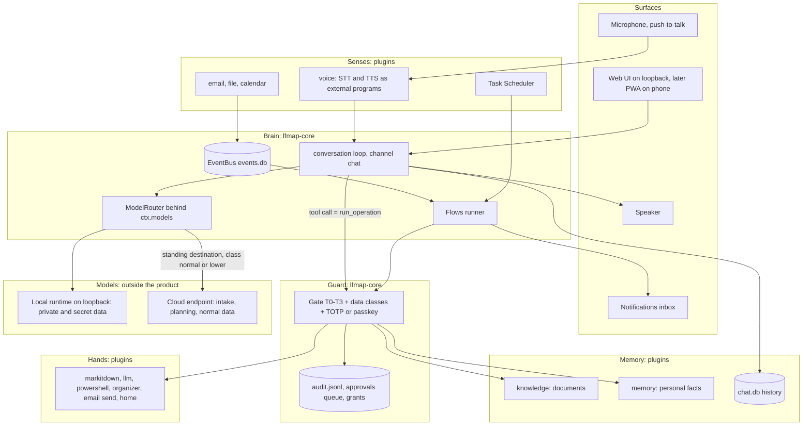

# Lan Hài as a JARVIS-style assistant: architecture sketch and solution choices

- Date: 2026-11-10. Role: Architect. Requested by Hùng (project thread "Phác thảo kiến trúc Lan Hài kiểu Jarvis").
- Epic: #157 (JARVIS roadmap after Phase 3, as LFMAP plugins). Related: #199 (passkey), #194 (web-first UI), #189 (ModelClient), #197 (data classes), #196 (backup).
- Status: **sketch, owner decisions of 2026-11-10 recorded in section 8** (revision 2, same day: rule 5 and section 4.2 rewritten for cloud intake). Docs only, no code, no ADR changed by this file, no issue scheduled. Everything that would touch an ADR, the Blueprint or the Roadmap is marked **[needs Hùng]** or listed as an ADR draft to write in section 9. Nothing here adds work to Phase 2.
- Sources: `/mnt/project-files/lfmap-docs/` 01–05 (Blueprint v0.3 §15, ADR-001..025, Roadmap), `ARCHITECTURE.md`, `docs/specs/` (model-client, chat-ui, flows, events), `docs/research/2026-11-08-architecture-review.md`.
- Limits of this file: licences and model facts in section 6 come from memory, not from a check of the current upstream files. Each is marked "verify"; none may be used before a License Register row exists. Latency and memory numbers are estimates until a spike measures them on pc-01.

## 1. Summary

1. **Lan is not a new system.** Lan is a set of plugins plus one conversation loop on the core that already exists. The assistant gets no path to a tool other than `run_operation`, so tiers, data classes, grants, audit and the approvals queue apply to it exactly as they apply to a flow.
2. **The model proposes, the core decides.** Whatever the model produces (a tool call, a flow draft, a memory fact) is data that the gate checks. A T2/T3 action from a conversation becomes a proposal, never an in-conversation "yes".
3. **Six building blocks**: senses (text, voice, events), brain (conversation loop, model routing), memory (documents, personal facts, history), hands (plugins), guard (gate, data classes, security plugin), surfaces (web UI, voice out, notifications, phone).
4. **Cloud plans, local handles private data** (owner decision 4): a cloud model takes the request in and plans; code, not the model, forces every step on `private`+ data to the local model; cloud use and each plan are approved once.
5. **Phase 2 already builds most of the skeleton** (ModelClient, Flows, EventBus, data classes, TOTP, backup, read-only chat UI). This sketch asks for **no new Phase 2 item**, only three reservations to keep in mind when the Phase 2 specs that are already planned get written (section 5).
6. **Order**: text assistant that acts (in Phase 3, owner decision 5), then after Phase 3 personal memory, then voice (push-to-talk), then proactivity, then phone, then IoT. Each stage is usable on its own.
7. **Honest ceiling on pc-01** (RTX 5060 Ti 16 GB, GPU jobs serial): a turn-based voice assistant in Vietnamese is realistic; full-duplex, interruptible speech with large-model reasoning fully local is not, on this hardware. Reasoning quality comes from the models (epic #157, "Out of scope"); the architecture keeps the door open to a stronger local machine or a gated cloud route without change.

## 2. What "JARVIS-equivalent" means here

Capability levels, so progress can be stated without hype. The epic estimated 15–20 % after Phases 1–3; the levels below show where the rest is.

| Level | The owner can | Needs | Earliest |
| --- | --- | --- | --- |
| L0 | Ask questions over own documents, with citations (MCP today) | knowledge, markitdown | done (Phase 1) |
| L1 | Chat with Lan in a window; Lan reads, searches, summarises; sees pending approvals | chat UI v1 read-only, `llm`, ModelClient | Phase 2 (planned) |
| L2 | Ask Lan to *do* things: Lan calls T0/T1 tools itself and files proposals for T2/T3; Lan drafts a flow from a sentence | conversation loop with tool calling, channel `chat`, approvals from the UI | Phase 3 |
| L3 | Lan remembers the owner (preferences, people, ongoing matters) across conversations, and can forget on request | plugin `memory` | after Phase 3 |
| L4 | Speak to Lan and hear the answer (push-to-talk, Vietnamese and English) | plugin `voice` | after Phase 3 |
| L5 | Lan speaks first: morning briefing, "an email needs you", reminders, under an interruption budget | plugin `briefing` on Flows + EventBus, notification surface | after Phase 3 |
| L6 | Same Lan from the phone; approvals with a passkey | PWA + private network, #199 | after Phase 3 |
| L7 | Lan controls devices at home | plugin `home` (bridge) | future, depends on hardware |
| L8 | Lan defends itself: incident detection and encrypted retreat to cloud | security S4 (Roadmap Phase 3) | Phase 3 |

## 3. Architecture

### 3.1 The six blocks

| Block | What it is | Where it lives | New or existing |
| --- | --- | --- | --- |
| Brain: conversation loop | Prompt assembly, model call, tool-call round trips, citations, stop. One loop for text and voice | `lfmap-core` (`chat.py` of `chat-ui.md` §2), Python stdlib + pydantic | planned (Phase 2 read-only, Phase 3 with tools) |
| Brain: model routing | Task to endpoint, data-class rule, cloud only through T3 | `lfmap-core` `models*.py` | exists (#189) |
| Brain: automation | Flows runner, EventBus, schedules | `lfmap-core` | exists |
| Guard | Gate, data classes, TOTP, grants, audit, approvals queue, backup | `lfmap-core` | exists or planned in Phase 2 |
| Senses | `voice` (speech in), `email`, `file`, `calendar` publish events or feed the loop | plugins | `email`, `file` Phase 2; rest later |
| Memory | `knowledge` (documents), `memory` (personal facts), conversation history | plugins + `chat.db` | knowledge exists; `memory` new |
| Hands | Every plugin operation | plugins | grows per need |
| Surfaces | Web UI, notification inbox, voice out, phone | static UI served by `lfmap serve rest`; `voice` | UI planned; rest new |

### 3.2 Rules that make it safe (proposed invariants)

These are the heart of the design. They restate existing invariants for the new channels, they do not weaken any.

1. **One door.** The conversation loop calls tools only through `run_operation` on channel `chat` (decided like `rest`, `chat-ui.md` §4). Voice is the same loop with speech at both ends, so it uses channel `chat` too. Proactive work is a flow, on channel `flow`. No new privilege path, no new channel rules to audit.
2. **A conversation never approves.** T2/T3 from a conversation becomes a proposal that shows the resolved input. Approval happens outside the model's reach: TTY with TOTP today (ADR-025), the approvals screen with a passkey later (#199). A spoken "yes" is never an approval, because a recording or another person in the room can say it.
3. **Untrusted text does not get hands.** Email bodies, web pages and document content are untrusted input. The dangerous combination is private data + untrusted content + a way to send out. Proposed rule: once a conversation or run has read untrusted content, the proposals it files are marked `tainted` and shown so; a tainted context can never use a time-limited grant for an external send (always a fresh T3 decision). This needs a provenance flag on tool results, which is the same mechanism as the class label that `model-client.md` §4 point 5 already requires before any cloud route is enabled.
4. **The class travels with the data.** Whatever enters the model context carries its data class (ADR-025); the context's class is the highest one in it; a `secret` context never goes to a cloud route (existing rule), and a memory fact inherits the class of its source.
5. **Cloud takes the request in, the data class decides where the work runs** (owner decision 4, 2026-11-10, replaces "local model by default"). Because of the hardware limit, a cloud model is the front door: it reads the owner's request, plans and assigns each step. Work on data of class `private` or higher runs on the local model by default and its results do not enter the cloud context; work on `normal` and lower runs on cloud or local according to the complexity judged at intake. The routing a model proposes is advice: code recomputes each step's class from the real inputs and forces `private`+ steps to local. Cloud use is approved once, centrally (section 4.2), not per call. There is still no automatic fallback from local to cloud; the other direction (cloud unreachable, intake falls back to local) is allowed. Speech audio, `secret` data and `private` memory never leave the machine.
6. **Lan speaks first only through the inbox.** Proactivity means a flow ends in a `notify` step that writes to a local inbox with a priority. Only the top priority may interrupt (sound or speech), within a daily budget the owner sets. Lan never starts a T2+ action on its own initiative; it files a proposal and says so.
7. **Everything Lan knows about the owner is inspectable and deletable.** Personal memory is stored as readable records with source and date; `forget` removes the record and its index rows; backup covers it (#196).
8. **Models stay outside the product.** No own inference engine (owner decision 2026-11-06). Speech and language models run in an external runtime or program, reached over loopback or as a subprocess on the allow-list pattern of `powershell` (ADR-020), the way Tesseract and Ollama are reached today.

### 3.3 Two flows, end to end

**"Lan, tóm tắt mail của anh Bình sáng nay rồi soạn trả lời" (voice, L4 + L2).** Push-to-talk records to a temp file in the plugin's `data_dir`; `voice.transcribe` (T0, local program) returns text; the pre-check passes and the cloud intake returns a plan; code marks the mail steps `private`, so the local model runs `email.search` (T0) and `llm.summarise` (local route) and the cloud sees only their status; email content marks the context tainted; the local model calls `email.draft` (T1, writes a draft in the mailbox's draft folder or a local file); Lan answers in speech with `voice.speak`. Sending is a separate T3 proposal that shows recipient and body; the owner approves on the approvals screen.

**Morning briefing (L5).** Task Scheduler starts flow `briefing` at 07:00: steps `calendar.today`, `email.unread_summary`, `approvals.pending`, `knowledge.changed_since`, then `llm.summarise` on the local route, then `notify` (T1) into the inbox. When the owner opens the UI or says "Lan, có gì mới", the inbox is read out. Nothing runs above T1, so nothing waits for approval.

## 4. Component designs (sketch level)

### 4.1 Conversation loop (core)

- Built on `ModelClient`. Its v1 has no streaming and no tool calling (`model-client.md` non-goals), so the loop needs a **ModelClient v2**: streaming and tool calling for OpenAI-compatible endpoints. This is the one real core extension in this sketch, and it is already implied by `chat-ui.md`; it belongs with the chat UI work, not earlier.
- Tools offered to the model are generated from the plugin manifests, as the MCP adapter does today, filtered by an owner-set allow-list per persona (`[assistant] tools = [...]` in `config.toml`). Fewer tools means better local-model accuracy and a smaller attack surface.
- Planning: for a multi-step request the model does not improvise a long chain of calls. It writes a **flow draft** (TOML, validated by `check_flow`) that the owner sees and starts. This reuses the Flows runner, its ceiling and its durable pause, and avoids a second orchestrator (ADR-024). Short requests (one to three T0/T1 calls) run directly in the loop with a hard step limit.
- Size target: the loop stays a small module like `flows_run.py` (a few hundred lines); a framework is reconsidered only by the named capabilities of ADR-024 note (iv).

### 4.2 Cloud intake and class-based routing (owner decision 4)

The pattern is "the planner sees the request and the catalogue, the workers see the data". It matches Blueprint §4.4 (multi-step reasoning on cloud, sensitive data local) and ADR-022.

| Step | Who | Sees | Produces |
| --- | --- | --- | --- |
| 0. Pre-check | code, no model | the request text | `local-only` when the owner's switch is on or an owner-set pattern matches (a path under a `private`/`secret` root, identity or card numbers, listed keywords); else the request is treated as `normal` |
| 1. Intake | cloud model (local model when step 0 says `local-only` or cloud is unreachable) | request, tool catalogue with tiers, the list of data roots by label and class (no contents), memory facts of class `normal` and lower | a plan as data (a flow draft): steps, the class each expects, a complexity mark, proposed executor `local` or `cloud` |
| 2. Check | code | the plan and the real inputs | `check_flow`; each step's class recomputed from its paths and inputs (ADR-025); executor forced to `local` for `private`+; plan refused when it routes `secret` anywhere but local |
| 3. One approval | owner | the whole plan: steps, which go to cloud with which class, every T2/T3 action with its resolved input | one decision for the plan, bound to the plan's hash |
| 4. Run | Flows runner; local model for `private`+ steps, cloud or local for the rest | each executor sees only its step's input | step outputs labelled with their class |
| 5. Answer | local model when any `private`+ output is part of the answer, otherwise the planner | | the reply; `private`+ outputs reach the cloud only as a handle and a status ("step 3 done, 4 items") |

"Approve once" has two parts, and both fit or extend rules that exist:

- **Cloud use as such:** one standing, time-limited `[approval.destinations]` entry for the cloud model endpoint, limited to class `normal` and lower. This is the existing invariant ("a person at a TTY or a preapproved destination"), so no rule changes; with it, a read-only plan (T0/T1) needs no question at all.
- **The plan:** one approval covers all its T2/T3 steps. Today a flow pauses at every step above its ceiling and never pre-approves (Flows invariant), so this needs an ADR. Proposed limits: the approval covers only steps whose input is fully resolved when the owner approves; a step whose content is produced later (an email body the model writes during the run) still pauses once at the send, because nobody can approve text that does not exist yet; any change to the plan or its inputs voids the approval; T3 in a tainted context stays a fresh decision (rule 3).

Consequences and open points:

1. **The request itself leaves the machine by default.** The cloud provider sees what the owner asks and the tool catalogue. This is the owner's decision; step 0 and a visible "local only" switch are the control. A request text has no path, so ADR-025's "unclassified = `private`" does not cover it: the rule "the owner's own request is `normal` unless step 0 matches" must be written into an ADR.
2. **Class labels on tool results become a hard precondition** (already the condition of `model-client.md` §4 point 5 before any cloud route). They move to the start of Phase 3.
3. **No downgrade by summary.** A local summary of `private` data is `private`. Lowering a class stays a TTY action with a code (ADR-025 (3)).
4. **Cost.** A cloud endpoint behind `ModelClient` is an API with a key, which is a paid service (project rule: paid APIs need the owner's approval; ADR-022 uses plan quota for development work, which an API client cannot use). Needed before the first real call: the owner's approval of a provider and a monthly cap, and a per-day token budget in `[models]` that the router enforces. The backlog item "token cost per workflow" becomes part of this.
5. **Local quality still matters.** The `private`+ steps (mail, personal documents, memory) are the ones a personal assistant does most, and they run on the local model. The Vietnamese tool-calling bench of section 6 therefore stays, now aimed at "extract, summarise, answer over given text" more than at planning.

### 4.3 Plugin `memory` (personal long-term memory)

Three kinds of memory, three stores, all local:

| Kind | Content | Store | Written by |
| --- | --- | --- | --- |
| Episodic | conversations | `chat.db` (planned in `chat-ui.md`) | the loop |
| Semantic | facts about the owner, people, ongoing matters, preferences | plugin `memory`: one SQLite table (subject, statement, source, class, created, last used, expires) | proposal from the model, accepted by the owner |
| Procedural | "how I like things done" | flows and the assistant's instruction file | the owner |

- Options for semantic memory: (A) Markdown notes in a declared folder that `knowledge` indexes; (B) own SQLite table in the plugin with FTS5, reusing `knowledge`'s chunk and embed functions through the SDK; (C) a third-party memory library.
- **Recommendation: B.** Facts are short records with a life cycle (confirm, update, expire, forget), which a table handles and loose notes do not; no dependency; C adds a dependency for what is one table and two queries. An export to Markdown keeps it readable.
- Write policy **[needs Hùng]**: (1) every fact needs a click; (2) facts of class `normal` and below are saved automatically and listed in a weekly review, `private` and above need a click. Recommendation: (2), because (1) trains the owner to click without reading, the same failure ADR-025 was written against.
- Retrieval: before each turn the loop asks `memory.recall` (T0) for the few facts that match, within a token budget; the facts' classes join the context class (rule 4).
- Not stored: credentials, health and identity documents of other people, anything from a `secret` root unless the owner writes the fact by hand.

### 4.4 Plugin `voice`

- Mode options: (A) push-to-talk (hotkey or button), turn-based; (B) wake word "Lan ơi", always listening; (C) full-duplex speech with interruption.
- **Recommendation: A first, B later as an option, C not on current hardware.** A has no always-on microphone, no wake-word model to license and no false triggers; it also makes "who spoke" a non-issue. B needs a small always-running process, which breaks today's "no background service" shape and therefore needs its own ADR **[needs Hùng]** when its turn comes.
- Pipeline: record (Windows audio API) → voice activity detection → speech-to-text → conversation loop → text-to-speech → play. Each model stage is an external program or loopback runtime (rule 8); the plugin holds only glue and the audio file handling in its `data_dir`. Audio files are deleted after transcription unless the owner turns on keeping them.
- Operations: `voice.transcribe(path) -> text` (T0), `voice.speak(text) -> path` (T0, writes own `data_dir`), `voice.listen()` (interactive, CLI/UI only, no MCP form). The first two are useful alone: dictation, reading a summary aloud, transcribing a meeting recording into `knowledge`.
- Budget on pc-01 (estimates, to measure in a spike): speech-to-text on CPU or a small share of the GPU; a 7–14B chat model on the GPU; text-to-speech on CPU. Target: first sound within about 3 seconds after the owner stops speaking, for short answers. GPU jobs are serial on pc-01, so voice and a reindex or a shadow run cannot share the GPU: the plugin must check a GPU lock and say "busy" instead of queueing silently.

### 4.5 Proactivity (`briefing`, `notify`, context)

- Mechanism: nothing new. Event or schedule triggers start flows; the flow's last step is `notify`. A small core operation or plugin `notify` writes inbox records (SQLite, own `data_dir`): text, priority, source run, expiry.
- Context signals, in the order of value against privacy cost: calendar (high value, low cost), unread mail and pending approvals (already there), files changed in declared roots (already there), active window title (low value, medium cost), screen content and location (**recommend not doing**: high privacy cost, heavy models, little use on a desktop).
- Calendar options: (A) read an `.ics` file or folder that the owner's calendar client exports or syncs; (B) CalDAV over the network; (C) Outlook through COM. Recommendation: A first (stdlib parser, no network, no secret), C when the owner uses Outlook on pc-01 (pywin32 is already in the License Register for MarkitdownTool); B needs credentials and a network rule, so later.

### 4.6 Multi-device

- Options: (A) the same web UI as a PWA, reached from the phone over a private network (WireGuard or a mesh VPN), no public port; (B) a chat-app bot (Telegram, Zalo) as a bridge; (C) an own cloud relay.
- **Recommendation: A.** One UI code base, nothing of the conversation leaves the owner's devices, and the passkey of #199 fits a browser. B sends every message through a third party (an external send on each turn, so T3 by the current rules) and C is a service to run. A needs the REST adapter to accept a non-loopback bind on the VPN interface only, which changes the invariant "no network beyond loopback": own ADR and `/security-review` **[needs Hùng]**.
- Notifications to the phone when the UI is closed: start with a content-free ping through a channel the owner already approved (for example an email "Lan: 1 việc chờ duyệt", no details), decided as an `[approval.destinations]` entry. Web Push is a later option; it involves the browser vendor's push service.
- Identity: the `principal` field (#192) is already there; add `device` to audit lines when the phone arrives.

### 4.7 Security plugin (S4) and IoT

- S4 stays as planned in the Roadmap (Phase 3): read-only Windows Security signals, and on an incident an encrypted, versioned snapshot pushed to the owner's cloud folder with the key kept off the machine. It builds on #196 snapshots and on the sync-folder approach of Blueprint §15.7 (no cloud drive API). Assistant-specific addition: on an incident Lan drops to **safe mode** (conversation loop offers T0 tools only, flows above T0 pause, cloud routes off) until the owner clears it at a TTY with TOTP.
- IoT (`home`): do not speak device protocols in-house. Bridge to one hub through its public local API (Home Assistant is the obvious candidate, used unmodified as an Internal component per ADR-021 (4)), with every device action declared as an operation with a tier: reading a sensor T0, lights T1, locks, doors, heating and anything that can harm T3. Decide only when the hardware exists.

## 5. Phase placement

"P2" = already in Roadmap Phase 2 (no change). "P3" = Roadmap Phase 3. "After" = after Phase 3, as #157 says.

| Part | Phase | Note |
| --- | --- | --- |
| ModelClient v1, `llm` plugin | P2 (done, #189) | |
| Data classes, TOTP (ADR-025) | P2 (#197) | rule 4 builds on it |
| Flows, EventBus, jobs as flows | P2 (done) | carrier for proactivity |
| `email`, `file`, `organizer`, `ocr` | P2 | Lan's first real hands |
| Backup snapshots S2, doctor S3 | P2 (#196, #198) | |
| REST + web UI v1 read-only, channel `chat` | P2 (#194) | L1 |
| `principal` in audit, proposals, grants | P2 (#192) | multi-device later adds `device` |
| ModelClient v2: streaming, tool calling | P3 (with chat that acts) | implied by `chat-ui.md`; not needed for read-only v1 if answers are not streamed |
| Conversation loop with tool calls, flow drafts, persona tool allow-list | P3 (owner decision 5) | L2 |
| Cloud intake, plan check, class-based executor, plan-level approval, token budget | P3 | section 4.2; ADR drafts first |
| Approvals from the UI with passkey | P3 (#199) | precondition for L2 being pleasant |
| Provenance flag (`tainted`) and class label on tool results | P3, first item: hard precondition of cloud intake | same mechanism as `model-client.md` §4 point 5 |
| Security S4 + assistant safe mode | P3 | L8 |
| `notify` inbox | P3 or After | small; needed by L5 |
| Plugin `memory` | After | L3 |
| Plugin `voice` (push-to-talk) | After | L4 |
| `briefing`, `calendar` | After | L5 |
| PWA on phone over private network | After | L6; ADR on non-loopback bind |
| Wake word, always-on listener | After, optional | ADR on a background process |
| `home` (IoT) | Future | hardware-dependent |

**Reservations for Phase 2 specs (no new work, only "do not close the door"):**

1. Channel `chat` is defined once and voice reuses it; do not create per-surface channels.
2. The class label on step outputs and `knowledge` content (already a condition in `model-client.md`) should be designed as a general label on tool results, so the `tainted` flag can join it later without a second mechanism.
3. The UI's approvals view shows proposals only; no approve button reachable by the model's output (already in `chat-ui.md` §4). Keep it that way when #199 adds approval from the UI.

**Roadmap (owner decision 5, 2026-11-10):** "Lan acts" (L2) is part of Phase 3, as the key point for competing with commercial agent harnesses. Phase 3 was "Productization" only (registry, marketplace, sync, Team Edition); how L2 is ordered against those items is settled in the Phase 3 plan.

## 6. Solution choices

Order per ADR-021: build in-house, then derive from permissive code, then adopt. "Verify" = licence and facts must be checked against the exact version before a License Register row is written; nothing below is approved by this file.

| Need | Options | Recommendation | Why |
| --- | --- | --- | --- |
| Conversation loop, planning | in-house on ModelClient; agent framework | **In-house** | ADR-024; the gate integration is the hard part and no framework provides it |
| Intake model (cloud) | any OpenAI-compatible endpoint the owner configures in `[models]` | owner chooses provider and cap (paid API, separate approval) | `ModelClient` already speaks this protocol; no provider SDK |
| Local model for `private`+ steps | models already on pc-01 through the loopback runtime; a model chosen by a Vietnamese bench | **Bench first**: 20–30 Vietnamese tasks (extract, summarise, answer over given text, simple tool calls), scored like the Working bench; rows in the model licence matrix | accuracy in Vietnamese on 16 GB is the real unknown |
| Speech-to-text | (a) whisper.cpp as an external program (MIT, verify), multilingual Whisper weights (MIT, verify) or a Vietnamese fine-tune such as PhoWhisper (licence verify); (b) faster-whisper as a Python dependency (MIT, verify; pulls CTranslate2); (c) sherpa-onnx (Apache-2.0, verify) with a Vietnamese model; (d) Windows built-in recognition (Vietnamese offline support: verify, believed missing) | **(a)**, compare (c) in the spike | external program on the Tesseract pattern, no Python dependency, no own engine; Vietnamese accuracy of the weights must be measured on the owner's own voice |
| Text-to-speech | (a) Windows built-in voices through WinRT/SAPI (Vietnamese voice "An": verify it is installable offline on pc-01); (b) Piper (the original MIT repo is archived, its successor is GPL-3.0 and both use an espeak-ng phonemiser under GPL-3.0: verify; **avoid** unless used strictly as a separate program after a licence decision); (c) sherpa-onnx TTS with a Vietnamese voice (verify model licence); (d) newer neural Vietnamese voices (several have non-commercial weights: verify each) | **(a) first**, (c) as the quality upgrade | zero dependency and zero model licence risk; quality is plain but understandable; swap later behind `voice.speak` |
| Voice activity detection | energy threshold in-house; Silero VAD (MIT, verify) | **In-house threshold** for push-to-talk | with push-to-talk the button already marks start and end |
| Wake word (later) | openWakeWord (code Apache-2.0, pretrained models non-commercial: verify); Porcupine (proprietary); sherpa-onnx keyword spotting (Apache-2.0, verify) | decide when the stage comes | model licences are the trap here |
| Personal memory | own SQLite table + FTS5 + existing embedder; third-party memory layers | **In-house** | one table; reuse `knowledge` functions |
| Calendar | `.ics` reader on stdlib; Outlook COM (pywin32, already registered); CalDAV | **`.ics` first** | no network, no secret |
| Notifications | own inbox table + UI badge; Windows toast (WinRT, verify how to call without a new dependency); phone ping by approved destination | **Inbox first**, toast second | inbox is needed anyway |
| Phone access | PWA + WireGuard (verify licences of the Windows client) or a mesh VPN service (third-party coordination server); chat-app bot | **PWA + private network** | no third party sees content |
| Approval from phone | TOTP (P2), WebAuthn passkey (#199) | as planned | |
| IoT | bridge to a hub's local API; own protocol code | **Bridge** | protocols are a maintenance sink for one person |
| Incident retreat | own snapshot + encryption with stdlib-available primitives or a vetted library (verify: Python stdlib has no authenticated cipher; this likely needs `cryptography`, Apache-2.0/BSD, verify, or Windows CNG through `ctypes`) | decide in the S4 spec | the cipher must not be home-made |

Dependency count if the recommendations hold: **zero new Python runtime dependencies** for L2–L5; two external programs (speech-to-text binary and its weights) plus Windows components. The cipher for S4 is the one place where adopting a library is probably right.

## 7. Risks

| Risk | Why it matters | Control |
| --- | --- | --- |
| Prompt injection through email, documents, web | an assistant with tools turns text into actions | rules 1–3; T3 always a fresh human decision in a tainted context; tool allow-list per persona |
| Approval fatigue | too many proposals and the owner clicks through | data classes (ADR-025), flow drafts instead of many single calls, weekly memory review instead of per-fact clicks |
| Local model too weak for work on `private` data in Vietnamese | the steps a personal assistant does most run local (decision 4) | bench before building; planning is done by the cloud intake; plans are checked by `check_flow` |
| The request text goes to a cloud provider by default | the provider sees what the owner asks | pre-check and "local only" switch (section 4.2); `private`+ results never enter the cloud context |
| Cloud cost without a ceiling | every request is a paid call | owner-approved provider and cap; daily token budget enforced by the router |
| One approval covers too much | a plan approved once could hide a harmful step | approval bound to the plan hash and resolved inputs; late-content steps pause; tainted T3 always fresh |
| GPU contention on one card | voice stalls behind reindex or a shadow run | GPU lock, small chat model for voice turns, speech models on CPU |
| Always-on microphone | privacy of everyone in the room | push-to-talk first; wake word only by ADR |
| Personal memory is a high-value target | one file describes the owner | class `private` minimum, never cloud, covered by backup encryption in S4, `forget` |
| Scope growth for one maintainer | eight levels, one person | each level is one or two plugins, usable alone, started only when the previous one is in daily use; no level starts before Phase 2 exit |
| Voice model licences | several good Vietnamese voices are non-commercial | Windows voice first; licence matrix row per model before use |

## 8. Decisions recorded (Hùng, 2026-11-10 08:26Z)

1. **Rules of section 3.2 accepted as the frame** for all Lan work. They become invariants in `ARCHITECTURE.md` when the first code lands. Rule 5 is the version rewritten by decision 4.
2. **Voice: push-to-talk first.** Streaming speech (wake word, always listening, full duplex) comes later, together with device integration.
3. **Memory write policy accepted:** facts of class `normal` and lower are saved automatically and listed in a weekly review; `private` and higher need the owner's click.
4. **Cloud intake.** Because of the hardware limit, a cloud model receives and processes the input, then routes the work by configuration: mining data of class `private` and higher runs local by default; `normal` and lower runs on cloud or local by the complexity judged at intake; approval is given once, centrally. Design: rule 5 and section 4.2. This replaces the sketch's recommendation "local model by default".
5. **"Lan acts" (L2) enters Phase 3**, because it is the key point for competing with commercial agent harnesses. Roadmap Phase 3 gets the line; the Phase 3 plan (separate thread) places it against registry and marketplace work.

Still open after these decisions (each is settled in the ADR draft or spec named in section 9, none blocks Phase 2):

- The limits of plan-level approval (section 4.2): a step whose content does not exist at approval time still pauses once.
- The rule that the owner's own request text counts as `normal` unless the pre-check matches, and the pre-check's patterns.
- Cloud provider, monthly cap and daily token budget (a paid API: needs the owner's separate approval before the first real call).

## 9. Follow-up work this sketch suggests (not scheduled)

- Spike S-voice (pc-01, about half a day, GPU night slot not needed): Windows Vietnamese voice offline, one speech-to-text program with two weight sets on 20 sentences of the owner's voice, end-to-end latency. Output: numbers for section 4.4 and License Register rows.
- Bench B-tools: Vietnamese tool-calling set for local chat models (reuses the bench harness).
- ADR drafts when their stage starts: conversation channel and provenance flag (L2); cloud intake (request text class, pre-check, standing destination for the cloud endpoint, token budget) and plan-level approval (amends the Flows invariant "a flow never pre-approves", ADR-017/018), both `gate:po` with `/security-review`; non-loopback bind for the phone (L6); background listener (wake word); personal memory rules (L3).
- Sub-issues of #157 are opened one at a time when a level is picked up (epic rule), not now.

## 10. Not covered

Phase 3 plan and productization (separate thread), ecosystem projects after lfmap (separate thread), threat model of Flows and ModelClient (separate thread), prices, branding and trademark (parked until Phase 2 ends).
