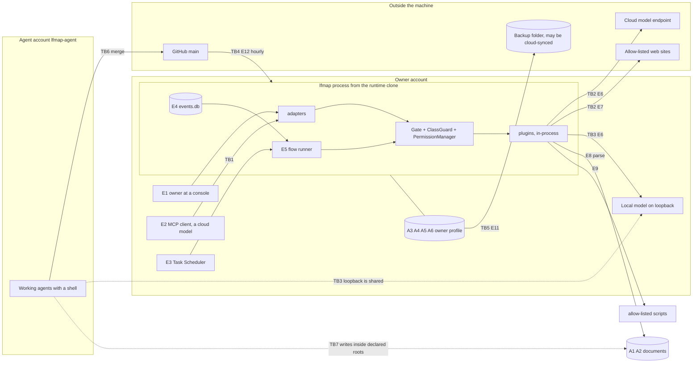

# Threat model for LFMAP after ADR-025: assets, entry points, abuse cases, gaps

- Date: 2026-11-13. Role: Architect / Reviewer. Issue #261 (item K7 of the 11/11 report).
- Scope: the product as it stands on `main` at `8abaa15` (core, the six plugins, jobs, flows, event bus, ModelClient, web fetch, backup), the way it is installed on pc-01 (ADR-023), and the path that brings code onto that machine. Planned parts (REST, chat UI, `claude -p` endpoint, `email`, `organizer`, Lan) get design requirements in section 9, not findings.
- Analysis only. No code, no ADR and no owner decision is changed by this file. Anything that touches an ADR or an earlier owner decision is marked **[needs Hùng]**.
- Sources: ADR-001..026, `ARCHITECTURE.md`, `docs/approvals.md`, `docs/specs/` (data-classes, model-client, flows, web-plugin, backup, rest, chat-ui, powershell), `docs/research/2026-11-10-lanhai-assistant-architecture.md`, and the code of `lfmap-core`.
- How each statement was checked: **probe** = confirmed by a throwaway test in a Cloud checkout (deleted, nothing committed); **read** = from reading the code; **doc** = from a spec or ADR only; **unverified** = depends on the state of pc-01 or GitHub settings, which a Cloud session cannot see (collected in section 10).

## 1. Verdict

The approval boundary is sound in its design: one gate for every channel, classes and tiers that only the owner's file can set, a separate Windows account for agents, and network paths that fail closed. Reading the code against the documents found no way for a caller on an agent channel to widen a folder, raise a ceiling, grant itself a right or reach a host the owner did not list.

The weak points are at the edges of that boundary, where two rules were written at different times and do not meet:

1. **`secret` content can leave through MCP** (G1, probe). ADR-017 (4) says a `secret` root never leaves the machine and `knowledge` enforces that, but every other reading operation (`markitdown.convert`, for one) returns a `secret` file to the MCP client after one audit line. The MCP client is a cloud model. This matters from the day `[data.classes]` gets its first `secret` entry (DC-7, #238).
2. **`main` becomes code running as the owner within an hour, and nothing on pc-01 checks who put it there** (G2, read + unverified). The runtime clone protects against an agent writing the folder, not against an agent merging a pull request. If the token of the agent account can merge, the account boundary of ADR-023 has a way round.
3. **A T3 action is approved with yes/no in most places** (G3, read). The owner code of ADR-025 (4) guards grants and old-style T3 proposals, but a T3 step of a flow and a T3 call typed at the CLI ask only yes/no. After JF-4 no proposal will ask the code at all.
4. **Document text reaches the backup** through flow run files, events and proposals (G5, read), although the backup was decided as "metadata only".
5. **Evidence and the root of trust are plain files** with no tamper evidence and no change notice (G7, read).

Fourteen gaps in all (section 7, issues #308 to #321): 2 high, 8 medium, 4 low. Ten are small changes in existing modules; G10 (provenance of untrusted content) is the one real piece of design work and is already a precondition of Phase 3. None of the fourteen needs a new dependency or a background service.

Scope warning: fourteen issues is more than a solo roadmap should absorb as separate work. Section 8 groups them into four cards and names the three to do before anything else.

## 2. Method

1. List what is worth protecting (section 3), who could attack and with what reach (section 4), and where input crosses a trust boundary (section 5).
2. For each entry point, write the abuse cases and look for the control in code, not only in a document (section 6).
3. A case with no control, or with a control that covers less than its ADR says, is a gap (section 7). A case the owner already decided to accept is a recorded residual risk (section 11), not a gap.

Out of scope: an attacker with Administrator or SYSTEM rights, kernel or hardware attacks, physical coercion, vulnerabilities inside Windows, Ollama, Tesseract or Office themselves, MarkitdownTool and isomp (own repositories, issues #6 to #9 there), multi-user and Team Edition, code-level review of each module (done per PR with `/security-review`; #263 reviews ModelClient).

## 3. Assets

| # | Asset | Where | Why it matters |
| --- | --- | --- | --- |
| A1 | Owner documents in declared roots, by class (`scratch`, `normal`, `private`, `secret`) | folders in `[paths]` | Confidentiality and integrity of the owner's work |
| A2 | `secret` data (contracts, identity documents) | `secret` entries of `[data.classes]` | Must never leave the machine (ADR-017 (4), ADR-025) |
| A3 | Root of trust: `config.toml`, `flows.toml`, `jobs.toml` | owner profile `%LOCALAPPDATA%\lfmap` | Holds roots, classes, allowed hosts, destinations, model routes, script allow-list and hashes, ceilings. Whoever writes it owns the gate |
| A4 | Authorisation state: `grants.json`, `approvals\`, `auth.json` (TOTP secret, DPAPI) | owner profile | A forged grant or proposal is an approval nobody gave |
| A5 | Evidence: `audit.jsonl`, `knowledge` `egress_log`, job logs | owner profile | The only way to see afterwards what ran and what left |
| A6 | Derived stores that hold content: `catalog.db` chunks, Markdown cache, vectors, flow run files, `events.db` payloads, saved web pages, later `chat.db` | owner profile | Copies of A1 and A2 outside the folders the owner classified |
| A7 | Credentials: cloud API key (environment variable), the Claude login used by `claude -p` (ADR-026), GitHub tokens, later the REST token, the Windows password stored for scheduled tasks | owner environment and profile | Reuse outside LFMAP, cost |
| A8 | Code that runs as the owner: `D:\lfmap-runtime`, its `.venv`, the updater in `%LOCALAPPDATA%\lfmap\bin`, tasks in `\LFMAP\` and `\LFMAP-Runtime\`, allow-listed scripts | pc-01 | Full rights of the owner account |
| A9 | Capacity and third parties: disk, GPU, the public sites that `web.fetch` reads, cloud quota and money | machine and outside | Availability; the owner answers for requests sent in his name |
| A10 | The owner's attention at an approval prompt | the person | Every control above T1 ends in a person reading before saying yes |

## 4. Attackers

| # | Attacker | Can | Cannot (assumed) |
| --- | --- | --- | --- |
| AT1 | Author of remote content: a web page, an email, a document, a file name | Put any text in front of a model or a parser | Run code, call an operation directly |
| AT2 | A misled agent on an agent channel: the MCP client today, a flow drafted by a model and the chat loop later | Choose which operation to call and with what input, read every result, answer an elicitation | Touch files or the console outside the adapter |
| AT3 | A process of the agent account `lfmap-agent` (Claude Code, Antigravity, qwen-loop with a shell) | Read the runtime clone, write `D:\Development` and `D:\Tmp`, create junctions there, open and listen on loopback ports, use the GPU, use its GitHub token | Read or write the owner's profile, write the runtime clone, type into the owner's console |
| AT4 | A process of the owner account: malware, a development tool or session started as the owner | Everything the owner can, including editing A3 and A4 and computing TOTP codes | Administrator rights |
| AT5 | Supply chain: a dependency, an installed distribution that registers a plugin, a model file, whoever can merge to `main` | Deliver code that the owner's processes import or run | (nothing assumed) |
| AT6 | Network attacker, or an allow-listed site that was taken over | Answer DNS, serve pages, read the logs of that site | Break TLS to a host with a valid certificate |
| AT7 | Whoever reads the disk or the backup folder: a thief, a cloud-drive account, another local user | Read plain files at rest | Log in as the owner |
| AT8 | The owner making a mistake | Mark a real folder `scratch`, set a harmful script to T1, approve without reading | (nothing assumed) |

ADR-023 places AT4 outside the boundary: nothing in LFMAP stops a process that already is the owner. The findings below therefore treat AT4 only for detection (does the owner find out) and for blast radius (what it gains beyond what it had).

## 5. Entry points and trust boundaries

| Boundary | Between | Held by |
| --- | --- | --- |
| TB1 | Agent channel and core | Gate tiers, `PermissionManager`, `ClassGuard`, no self-granting operation on MCP |
| TB2 | Machine and network | Loopback rule, `[web] allowed_hosts`, cloud route through T3, egress lines |
| TB3 | Owner process and other local processes on loopback | Nothing: loopback has no notion of account (G4) |
| TB4 | `main` and code running as the owner | CI, CodeQL, review by agents, `gate:po` for some paths; no check on pc-01 (G2) |
| TB5 | Owner profile and the backup folder | Declared folder, SHA-256 manifest, TTY and owner code for restore (G5, G6) |
| TB6 | Agent account and `main` | GitHub permissions and branch rules (unverified, G2) |
| TB7 | Agent account and files the owner's process reads or writes | `realpath` check at the time of the call (G12) |

Entry points: E1 CLI at a console; E2 MCP stdio; E3 scheduled jobs and flows; E4 event bus; E5 flow definitions and `${...}` references; E6 ModelClient (local and cloud); E7 `web.fetch`; E8 documents parsed by `markitdown` and indexed by `knowledge`; E9 `powershell.run`; E10 config and state files; E11 backup and restore; E12 runtime update, dependencies and plugin discovery; E13 REST and chat UI (planned); E14 `claude -p` endpoint (planned).

## 6. Abuse cases mapped to controls

Verdict: **Covered** (a control exists in code and has a test), **Accepted** (owner decision, section 11), **Tracked** (open issue), **Gap** (section 7).

### E1 CLI at a console

| # | Abuse case | Attacker | Control | Verdict |
| --- | --- | --- | --- | --- |
| AC-01 | A script or agent runs a self-granting command (`approvals grant`, `config add-folder`, `data classify` lowering, `backup restore`) | AT3 | Real-console check, visible window, owner code (TOTP or typed), separate account so the files are out of reach (ADR-023) | Covered |
| AC-02 | The same by a process of the owner account | AT4 | None by design | Accepted (R1) |
| AC-03 | A T3 call or a T3 flow step is answered with yes/no by whatever can type into the console | AT4, AT8 | Console check only; the owner code is not asked | Gap G3 |
| AC-04 | A file outside the roots is read because a person typed its path | AT8 | `explicit_read` only at a TTY, never network paths, audited | Covered |

### E2 MCP

| # | Abuse case | Attacker | Control | Verdict |
| --- | --- | --- | --- | --- |
| AC-05 | Read or write outside declared roots, UNC or device paths, link that leaves a root | AT2 | `PermissionManager`: string check before I/O, `realpath`, inline `startswith` | Covered |
| AC-06 | Self-approve an overwrite or delete (T2) through elicitation | AT2 | T2 accepts elicitation by decision; the client is one the owner registered; T3 never accepts it | Accepted (R4) |
| AC-07 | Reach T3 (send out, paid API, external command) | AT2 | Refused without a grant made at a TTY or a preapproved destination; `--approve` never covers `external` | Covered |
| AC-08 | Pull `secret` content into the cloud model's context | AT2, AT1 through AT2 | `knowledge` hides `secret` roots on `mcp` and `rest`. `ClassGuard` only audits a `secret` read (T1) and lets it run on every channel | Gap G1 |
| AC-09 | Pull `private` content without the owner being asked | AT2 | By decision the registered MCP client is a destination for `normal` and `private` (ADR-017 (4)); `knowledge` writes `egress_log`, other plugins write nothing | Accepted (R3); logging part in G1 |
| AC-10 | Change roots, classes, hosts, grants, script list | AT2 | No operation writes `config.toml`; self-granting commands have no MCP form | Covered |
| AC-11 | Tool results carry instructions that steer the client | AT1 | `untrusted = true` on `knowledge` and `powershell` results only; nothing on `web.fetch`, `markitdown.convert`, `llm.*` | Gap G10 |
| AC-12 | Use `web.fetch` to carry data out in the URL | AT2 | Allow-list, rate limit, query over 200 characters is T3; the path is not bounded | Gap G11 |
| AC-13 | Run a harmful command through `powershell.run` | AT2 | Allow-list in `config.toml`, SHA-256 pin, typed arguments, no shell, tier per script (default T3) | Covered; environment in G9 |

### E3 Scheduled jobs and flows, E5 flow definitions

| # | Abuse case | Attacker | Control | Verdict |
| --- | --- | --- | --- | --- |
| AC-14 | An unattended run does more than the owner allowed | AT1, AT8 | Ceiling `max_tier` 0 or 1; anything above becomes a `flows.resume` proposal; no grant, pre-approval or destination applies on `job`, `event`, `flow` | Covered |
| AC-15 | The scheduled task runs code an agent can write | AT3 | Tasks start from `[runtime] root`; `jobs doctor` `runtime_root` and `runtime_acl` | Covered locally; upstream path in G2 |
| AC-16 | The flow or its input is changed between the pause and the approval | AT3, AT4 | `check_resume`: flow file hash, proposal equals the re-resolved step | Covered |
| AC-17 | A forged or altered proposal file is approved | AT3 | Owner-profile ACL (the agent queues into its own profile), schema validation on every read, escaped display (`approvals.visible`) | Covered |
| AC-18 | A reference expression reads a file, the environment or runs code | AT2 | Grammar is `${root.key...}` only; pure resolver | Covered |
| AC-19 | The data class is lost between steps, so a later step sends `private` text to cloud | AT2 | Cloud routes stay off (`allow_cloud_unlabelled` default false) until labels travel | Tracked #237 (DC-6), #236 (DC-5) |
| AC-20 | Many proposals bury the one that matters | AT1, AT2 | Identical calls reuse one proposal; no cap per flow | Gap G13 |

### E4 Event bus

| # | Abuse case | Attacker | Control | Verdict |
| --- | --- | --- | --- | --- |
| AC-21 | A plugin publishes another plugin's or core's topics | AT5 | Topic ownership, core topics refused, `[adapters] events = true` required | Covered |
| AC-22 | A redelivered event repeats a side effect | (none) | Run id per event and flow; handlers idempotent | Covered |
| AC-23 | Event payload values chosen by a remote author (a future `email` event) flow into step inputs | AT1 | Paths are re-checked by `PermissionManager`, tiers apply to each step; no mark that the value came from outside | Gap G10 |
| AC-24 | The request-over-bus path keeps a second ceiling and proposal kind | (design) | Being removed | Tracked #239 (JF-2), #241 (JF-4) |

### E6 ModelClient

| # | Abuse case | Attacker | Control | Verdict |
| --- | --- | --- | --- | --- |
| AC-25 | `secret` or `private` text sent to a cloud endpoint | AT2, AT5 | Cloud needs an owner-written endpoint and route, `cloud_ai` and `network` in the manifest, class not `secret`, T3; `max(declared, call label)` after DC-5 | Covered; label part tracked #236 |
| AC-26 | Request redirected or proxied to another host | AT6 | No redirects, proxy variables ignored, certificate checks on | Covered |
| AC-27 | A fake "local" model: another account listens on the model port and receives the prompts | AT3 | Host must be loopback; nothing checks who listens | Gap G4 |
| AC-28 | Model output decides an action | AT1 | `extract` and `classify` validated by code; no operation acts on model text without its own gate | Covered today; Phase 3 loop in section 9 |
| AC-29 | The API key leaks | AT2, AT5 | Header only, never in logs or errors; the variable is inherited by every child process | Gap G9 |
| AC-30 | Cloud quota or money is drained | AT2 | T3 per call; the daily cap of ADR-026 is not built yet | Section 9 |

### E7 `web.fetch`

| # | Abuse case | Attacker | Control | Verdict |
| --- | --- | --- | --- | --- |
| AC-31 | SSRF to loopback, the LAN or cloud metadata; DNS rebinding | AT2, AT6 | Allow-list first, every resolved address must be global, connect to the checked address | Covered |
| AC-32 | Redirect to a host outside the list or to `http` | AT6 | Every hop restarts all checks | Covered |
| AC-33 | Download or decompression bomb, slow server | AT6 | Byte cap on decompressed output, bounded wire bytes, wall-clock deadline, text types only | Covered |
| AC-34 | A job hammers a public site | AT8 | Per-host window across processes, per-run cap | Covered |
| AC-35 | A taken-over allow-listed site serves text written to steer later steps | AT6, AT1 | Page text is returned as data and never parsed; no mark travels with it | Gap G10 |
| AC-36 | A plugin swaps `ctx.web_fetcher` for its own | AT5 | None; plugins are trusted in-process code | Accepted (R2) |

### E8 Documents, E9 scripts

| # | Abuse case | Attacker | Control | Verdict |
| --- | --- | --- | --- | --- |
| AC-37 | A crafted document exploits a parser (MarkItDown, OCRmyPDF, Docling) inside the owner's process | AT1, AT5 | File size and count limits, opened streams only, no network; no sandbox | Accepted (R2); dependency hygiene in G8 |
| AC-38 | Text planted in an indexed folder comes back as retrieved context | AT1, AT3 | `untrusted = true` on results, citations show the file | Covered for marking; propagation in G10 |
| AC-39 | A script is edited after it was allow-listed, or swapped between check and start | AT3 | SHA-256 pin, the checked bytes are copied and the copy runs | Covered |
| AC-40 | Script arguments inject a command | AT2 | Typed parameters, patterns, no shell, `-File` | Covered |

### E10 Config and state, E11 backup, E12 update and supply chain

| # | Abuse case | Attacker | Control | Verdict |
| --- | --- | --- | --- | --- |
| AC-41 | The agent account edits `config.toml`, `grants.json` or a proposal | AT3 | Owner-profile ACL. `jobs doctor` checks the ACL of the runtime root and `auth.json` only | Covered by default ACL; check and change notice in G7 |
| AC-42 | An owner-level process edits the root of trust or erases audit lines and nobody notices | AT4 | None | Gap G7 |
| AC-43 | Document text ends up in the backup zip | AT7 | `catalog.db` is scrubbed; run files, `events.db` and proposals are copied as they are | Gap G5 |
| AC-44 | A planted or altered zip is restored and replaces `config.toml` and `grants.json` | AT3, AT7 | TTY and owner code, member names and hashes checked against the manifest inside the same zip | Gap G6 |
| AC-45 | Code merged to `main` runs as the owner | AT3, AT5 | CI, CodeQL, Provenance workflow, agent review, `gate:po` on `.claude/`, ADR and policy changes; the updater takes any fast-forward of `origin/main` | Gap G2 |
| AC-46 | An installed distribution registers itself as a plugin | AT5 | `uv.lock`, licence gate, read-only runtime clone; every `lfmap.plugins` entry point is imported | Gap G8 |
| AC-47 | A directory inside a declared root is swapped for a junction between the check and the file operation | AT3 | `realpath` at check time | Gap G12 |
| AC-48 | Disk or profile read at rest | AT7 | Windows account; nothing checks disk encryption | Gap G14 |

## 7. Gap register

Severity: **H** = defeats a rule the owner believes is in force; **M** = weakens a boundary or the evidence; **L** = hardening.

### G1 (H, #308) `secret` content leaves through MCP for every reading operation except `knowledge`

- Evidence (probe): a T0 operation on channel `mcp` reading a file under a `secret` entry returned normally; the only trace was `{"channel": "mcp", "tier": "T1", "action_tier": "T0", "data_class": "secret", "decision": "allow", "reason": "secret_read"}`. `ClassGuard.on_path` raises the tier and never looks at the channel; `docs/specs/data-classes.md` section 5.4 lists "read in `secret` on `mcp`: runs, audited".
- Conflict: ADR-017 (4) "root secret không bao giờ ra ngoài", and the invariant "`secret` ... its content never goes to a cloud endpoint", which today is true for `ModelRouter` and `knowledge` only. The MCP client is a cloud model, so `markitdown_convert` on a contract in a `secret` folder inside a `markitdown` root sends the text out.
- Options: (A) core refuses a `secret` read on egress channels (`mcp`, `rest`, later `chat` when its model is cloud) in `ClassGuard`, the same list `knowledge` uses; (B) make it T3 there (a TTY grant can open it for a while); (C) keep T1 and rely on the owner not putting `secret` folders under MCP-served roots.
- **Recommendation: A**, about ten lines and three tests; B if the owner wants a way to show a `secret` file to Claude on purpose. Amends the ADR-025 table ("`secret` read is T1") by channel **[needs Hùng]**.
- Also in this issue: a non-`knowledge` read of `private` content on `mcp` leaves no egress record (AC-09). Cheapest form: one audit line per call when the call label is `private` or higher on an egress channel.
- Until fixed: at DC-7 do not classify as `secret` a folder that lies inside a `[paths]` root of a plugin served on MCP, or serve MCP with `--plugins` that leaves `markitdown` out.

### G2 (H, #309) `main` runs as the owner within the hour; pc-01 checks nothing about the commit

- Evidence (read): `Update-LfmapRuntime.ps1` does `fetch`, `merge --ff-only origin/main`, `jobs doctor`, every hour and at logon. No signature check, no check-run state, no delay, no owner step. Tasks and the owner's MCP server then run that tree.
- Why it defeats ADR-023: the account split stops `lfmap-agent` from writing `D:\lfmap-runtime`, but the same account holds a GitHub token (`GH_TOKEN`), and Cloud sessions merge pull requests when CI is green. Whether that token can merge or push to `main` is **unverified** (V1, V2). If it can, a misled agent on pc-01 reaches owner rights through GitHub in about an hour, with a clean audit log.
- Options: (A) GitHub side only: branch rule on `main` (pull request, required checks, no direct push) and an agent token that cannot merge; (B) add an updater rule: advance automatically only when the new commits leave a fixed list of sensitive paths untouched (`approval.py`, `approvals.py`, `permissions.py`, `data_*.py`, `auth.py`, `totp.py`, `cli.py`, `models_*.py`, `web*.py`, `runtime.py`, `registry.py`, `scripts/`, `uv.lock`, any `lfmap.toml`), otherwise hold and show a line in `lfmap doctor` until the owner runs one accept command with the owner code; (C) updater verifies commit signatures.
- **Recommendation: A now (settings, no code), then B.** B keeps unattended updates for most merges and puts a person on exactly the changes that could move the boundary; it matches the existing `gate:po` idea but enforces it on the machine instead of trusting the merge side. C adds key handling for little gain while merges are made by GitHub's web flow. **[needs Hùng]** (changes how updates reach pc-01).

### G3 (M, #310) T3 is approved with yes/no where ADR-025 (4) asks for the owner code

- Evidence (read): `_execute` always queues `flows.resume` as T2; `approve_flow` asks `typer.confirm`; the T3 step then goes to the fallback CLI gate, which asks one more yes/no. Only a plain-call proposal with recorded tier T3 reaches `_require_code`, and that kind disappears with JF-4. A T3 call typed at the CLI is also yes/no.
- Effect: the second factor protects granting a right but not using T3 once, which is the more common event. After JF-4 `test_t3_proposal_needs_code` protects a path that no longer exists.
- Options: (A) record the waiting step's own tier in the `flows.resume` proposal and ask the owner code when it is T3; (B) also ask the owner code for every interactive T3 at the CLI; (C) leave as is and correct the ADR text.
- **Recommendation: A inside JF-4 (#241)**, B as an owner choice (more friction, same rule everywhere) **[needs Hùng]**.

### G4 (M, #311) Nothing proves who listens on a loopback port

- Evidence (read): a `local` endpoint is accepted when its host is loopback. Loopback is shared by all Windows accounts, and Ollama has no authentication. When Ollama is not running, `lfmap-agent` can listen on `127.0.0.1:11434`, receive every prompt and every text sent for embedding, including `secret` content (local endpoints accept any class), and return chosen output. The planned REST adapter has the mirror problem: a client that sends its bearer token to a squatter on the fixed port gives the token away.
- Options: (A) `lfmap doctor` check: the process that owns the model port runs as the owner or a named service account; (B) the router performs that check before a call whose label is `private` or higher and fails closed; (C) REST: the server writes its port to a file in the owner profile and clients read it from there, so a fixed port is never trusted.
- **Recommendation: A now, C in the REST work (#194), B when DC-5 has landed.** How to read the owning account of a listener without Administrator rights must be checked on pc-01 first (V6).

### G5 (M, #312) Document text reaches durable state and the backup

- Evidence (read): `flows_run` stores each step output (up to 64 KiB) in the run file; `events_adapter._completed` puts the operation output into the `.completed` payload; a `flows.resume` proposal holds `resolved_input`. `backup.py` copies `flows/runs`, `approvals` and `events.db` unchanged. So the output of `web.fetch`, `markitdown.convert` or `llm.summarise` over a `secret` file is in the zip, which may sit in a cloud-synced folder. "Outputs carry references, not document text" is a convention no code enforces.
- Options: (A) the backup drops step outputs, event payload bodies and `resolved_input` values, keeping status, ids, sizes and hashes; (B) the run file itself stores only a hash and size for an output whose call label is `private` or higher, which needs the per-step label of DC-6; (C) encrypt the zip (rejected by the owner on 2026-11-08 for the metadata-only design).
- **Recommendation: A now** (small, keeps the decided design true), **B with DC-6 (#237)** and the retention work of JF-3 (#240).

### G6 (M, #313) A restored backup is trusted as the new root of trust

- Evidence (read, doc): restore verifies member hashes against a manifest stored in the same zip, then swaps in `config.toml`, `grants.json`, `flows.toml`, `jobs.toml` and proposals. Whoever can write the backup folder (a cloud-drive account, another local account if the folder ACL allows it) can prepare a zip with wider roots, a destination, an allow-listed script and a grant. The owner restores after a loss, when there is nothing to compare with.
- Options: (A) restore never restores `grants.json` and pending proposals (they are short-lived by design); (B) restore prints the security-relevant keys of the incoming `config.toml` (roots, classes, hosts, destinations, model endpoints, scripts, ceilings) before the owner code is asked; (C) `jobs doctor` checks the backup folder with `other_writers`; (D) a keyed signature (the key would have to survive the loss of the machine, so it becomes a second secret to keep).
- **Recommendation: A + B + C.** D only if backups are ever restored unattended.

### G7 (M, #314) No tamper evidence for the audit log and no notice when the root of trust changes

- Evidence (read): `audit()` appends plain JSON lines; nothing links one line to the next, the file is never rotated, and `LFMAP_CONFIG`, `LFMAP_FLOWS`, `LFMAP_JOBS` and `LOCALAPPDATA` redirect where the root of trust is read from. `jobs doctor` checks ACLs of the runtime root and `auth.json` only.
- Effect: an AT4 process that widens a root, adds a host or a destination and trims the log leaves nothing for the owner to find. This does not stop AT4 (R1); it decides whether the owner learns of it.
- Proposal: (1) each audit line carries the SHA-256 of the previous line, `lfmap audit verify` and a doctor check walk the chain, and each backup manifest records the last hash, so an edit must also reach the older backups; (2) the gate writes one `config changed` line (file name, old and new hash, never content) the first time it sees a new hash of `config.toml`, `flows.toml` or `jobs.toml`; (3) `jobs doctor` extends `other_writers` to those files, `grants.json` and `approvals\`, and warns when one of the override variables is set in a scheduled task or the MCP server environment; (4) monthly rotation.
- About 60 lines in `approval.py` and the doctor; no dependency.

### G8 (M, #315) Every installed distribution that registers `lfmap.plugins` is loaded

- Evidence (read): `Registry.discover` imports each entry point of the group. A plugin is in-process code with the owner's rights; importing it runs it, before any manifest check.
- Effect: a dependency (direct or transitive) that adds the entry point becomes a plugin on every channel. The lock file and the read-only clone make this hard today; the first third-party plugin makes it the main supply-chain door.
- Proposal: `[plugins] enabled = [...]` in `config.toml`; the name is compared before `point.load()`; with no table the first-party ids are the default; `lfmap doctor` lists what is installed but not enabled. Needed before any plugin from outside the repository (ADR-019, Phase 3).

### G9 (M, #316) Child processes inherit the whole owner environment

- Evidence (read): `runner.run_process` passes no `env`, so an allow-listed script gets every variable, including the one named by `api_key_env`, and its output goes back to the caller (over MCP, to a cloud model). The same holds for OCR subprocesses and will hold for `claude -p`.
- Proposal: the runner builds a minimal environment (system paths, temp, profile) plus names the allow-list entry lists under a new `env = [...]` key; core offers one helper so every plugin that starts a process uses it; the API key moves out of the environment later (model-client decision 2 is "easy to change").

### G10 (M, #317) Untrusted content carries no mark that later steps or callers can act on

- Evidence (read, doc): `untrusted = true` exists on `knowledge` and `powershell` results only. Rule 3 of the Lan sketch ("untrusted text does not get hands", a `tainted` flag) has no issue. Chains such as page text to `llm.extract` to a URL or a script argument are bounded today only by typed inputs and tiers.
- Proposal: one provenance field next to the class label (same carrier as DC-6): a call that read web, mail or indexed content marks its output; a flow step whose input references a marked output is marked; a marked context cannot use a destination pre-approval or a grant for T3 (always a fresh decision). Short term: add the `untrusted` field to `web.fetch`, `markitdown.convert` and `llm.*` outputs, and a `flows check` warning when a step with `external` side effects takes a reference to such an output.
- First item of Phase 3 (precondition of the conversation loop with tools), together with #237.

### G11 (L, #318) The URL path of `web.fetch` is an unbounded outbound channel

- Evidence (read): `long_query` counts the query only (`QUERY_T3_LIMIT = 200`); the path may fill the 2048 characters. At 12 requests a minute per host this is about 20 KiB a minute at T0, unattended.
- Bound today: the receiver must be an allow-listed public host, so the reader of the data is that site's operator or whoever reads its logs.
- Proposal: apply the limit to path plus query (the two S1 sites need to be measured first), or let the owner give URL prefixes per host. Owner decision 16.1 of the web spec set the query rule; this extends it **[needs Hùng]**.

### G12 (L, #319) Path checks are made before use; a root another account can write is exposed to a swap

- Evidence (read): `_require` resolves, checks, and returns a path that the plugin opens later. `lfmap-agent` can write `D:\Development` and `D:\Tmp` and can create junctions without special rights. If such a folder is also a write root of an owner-run plugin (an export folder, a `scratch` entry), a swap between check and open makes the owner's process write outside its roots.
- Proposal: (1) `jobs doctor` warns when a `[paths]` root or a `[data.classes]` entry is writable by another account (reuses `other_writers`); (2) later, a core helper that opens first and checks the final path of the open handle for writes. (1) is the cheap part and removes most of the exposure by configuration.

### G13 (L, #320) No bound on what unattended work can pile up

- Evidence (read, doc): no cap on pending proposals per flow, `audit.jsonl` and `events.db` grow until someone prunes at a TTY, saved pages are never deleted, run files wait for JF-3.
- Proposal: at most N pending proposals per flow or job (then refuse with one audit line), doctor warnings on file sizes, retention for `data_dir/pages`. Fold into JF-3 (#240) where it touches run files.

### G14 (L, #321) Content at rest depends on disk encryption that nothing checks

- Evidence (read): chunk text, the Markdown cache, run files and the audit log are plain files; `security_doctor.py` checks Defender and Controlled Folder Access only.
- Proposal: one more read-only warning in the `security` group when the system and data volumes are not encrypted. The way to read that without Administrator rights is to be confirmed on pc-01 (V7).

## 8. Order of work

The fourteen gaps fit four cards plus two items that ride on existing issues. Environment: all Cloud (Claude Code), except the checks of section 10 which need pc-01.

| Order | Card | Gaps | Why here |
| --- | --- | --- | --- |
| 1 | `secret` on egress channels | G1 | Before or right after DC-7 puts the first `secret` entry in place |
| 2 | GitHub settings and token scope (owner, 15 minutes), then the updater hold | G2 | The only path found from the agent account to owner rights |
| 3 | Inside JF-4 (#241) | G3 | The code is being rewritten there anyway |
| 4 | Backup card | G5 (A), G6 | Keeps "metadata only" true before real flows produce outputs |
| 5 | Evidence and doctor card | G7, G4 (A), G12 (1), G14 | Mostly `jobs_doctor.py` and `approval.py`, one PR with `/security-review` |
| 6 | Process and plugin hygiene card | G8, G9 | Before the first third-party plugin and before `claude -p` |
| 7 | With DC-6 (#237), Phase 3 start | G10, G5 (B) | One carrier for class and provenance |
| later | With JF-3 (#240) and the web plugin | G13, G11 | Low |

## 9. Requirements for parts not built yet

These are not gaps today. Each becomes one when the part is written without it.

| Part | Requirement |
| --- | --- |
| REST adapter (#194) | Rules R2 to R8 of `docs/specs/rest.md` as written; port from a file in the owner profile, not a constant (G4); `rest` stays an egress channel for G1 |
| Chat loop, channel `chat` | Counts as an egress channel whenever the conversation model is a cloud route; a conversation never approves (Lan rule 2); tool results enter the context with class and provenance (G10); hard step limit |
| `claude -p` endpoint (ADR-026) | Counts as `kind = "cloud"` for every class rule and writes `model_call` lines; all tools off; prompt on stdin, not in arguments; minimal environment (G9); no session reuse between calls; the daily call cap enforced by the router and fail closed; `/security-review` |
| Plan-level approval (Lan 4.2) | Approval bound to the hash of the plan and its resolved inputs; a step whose content does not exist yet still pauses; a marked (untrusted) context never uses a standing approval for T3 |
| `email` plugin | Mailbox credentials outside `config.toml` and the environment; events carry references and are marked untrusted (G10); sending is T3 with recipient and body shown |
| `organizer` | Moves only within a class or upwards (ADR-025); proposes classes, never sets them; journal for undo |
| Phone or PWA | A non-loopback bind is a new invariant: own ADR, device identity in audit lines, passkey for approvals (#199) |
| Approvals from a UI | The click must be proven outside the webview and outside the model's reach; T3 keeps the owner code or passkey |

## 10. What a Cloud session could not verify (owner, on pc-01 and GitHub)

Tracked in #322.

| # | Check | Affects |
| --- | --- | --- |
| V1 | Branch rule on `main` of the three repositories: pull request required, required checks, no direct push, no force push | G2 |
| V2 | Scope of the `lfmap-agent` token `lfmap-agent-pc01`: can it merge a pull request or push to `main`? | G2 |
| V3 | Which Windows account runs Claude Desktop, Remote Control sessions and Claude Code on pc-01 today, and whether `C:\Users\Admin\.claude\settings.json` still allows `Read`/`Edit` on `%LOCALAPPDATA%\lfmap` (rule set on 2026-10-22, before ADR-023) | R1, ADR-023 |
| V4 | Is the `[backup] folder` inside a cloud-synced folder, and who can write it | G5, G6 |
| V5 | Which `[paths]` roots can `lfmap-agent` write (`icacls`) | G12 |
| V6 | Which account owns the listener on port 11434, and can a standard user read that | G4 |
| V7 | Are C: and D: encrypted (BitLocker or device encryption) | G14 |
| V8 | Is `serve mcp` started with `--approve`, and for which operations | R4 |

V3 is the one that could turn an accepted risk into an open door: an agent session that runs as the owner with edit rights on the owner profile is AT4, and every control in this file assumes agents are AT3.

## 11. Residual risks the owner already accepted

Listed so they are not raised again as findings.

| # | Risk | Decided in |
| --- | --- | --- |
| R1 | A process of the owner account can edit config and grants, read `auth.json` and compute codes | ADR-023; data-classes spec 9.6 |
| R2 | Plugins and their libraries run in-process with the owner's rights; core is not a sandbox | Plugin Contract; `ARCHITECTURE.md` invariants |
| R3 | The registered MCP client receives `normal` and `private` content without a question | ADR-017 (4) |
| R4 | T2 on MCP accepts elicitation or `--approve` | ADR-017 (2), (3) |
| R5 | A grant on `powershell.run` covers every allow-listed script | ADR-020; powershell spec 7 |
| R6 | A URL query up to 200 characters is an outbound channel at T0 | Web spec decision 16.1 |
| R7 | `auth reset` needs only a console and the typed code | Data-classes spec 9.6 |
| R8 | `private` text declared `normal` by an agent can reach a destination approved for `normal` | Data-classes spec 8.4 |
| R9 | The backup is not encrypted | Backup decision 2026-11-08 (holds only while G5 is closed) |
| R10 | A script the owner set to T1 that is in fact harmful runs unasked | ADR-020 risk table |

## 12. When to redo this file

At the end of Phase 2; before the first cloud route is enabled; before the REST adapter or the chat loop is merged; when a second machine or a second person appears; after any incident. Each redo starts from the section 6 tables and re-runs the probes.
